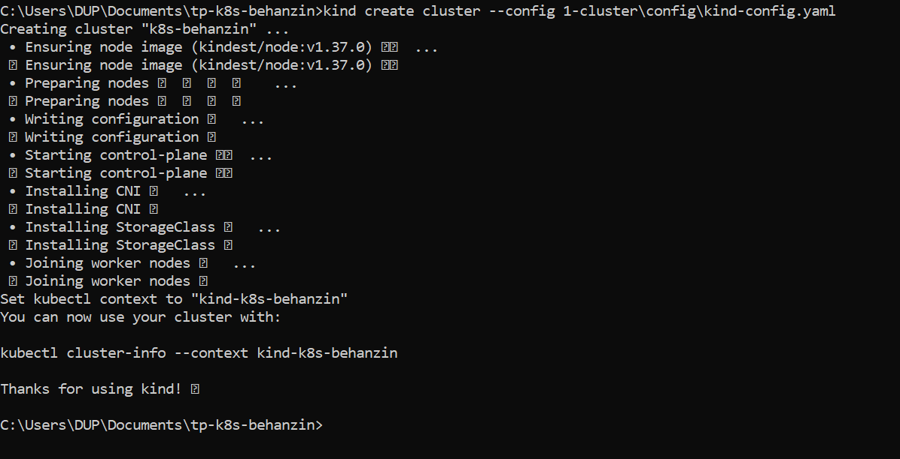
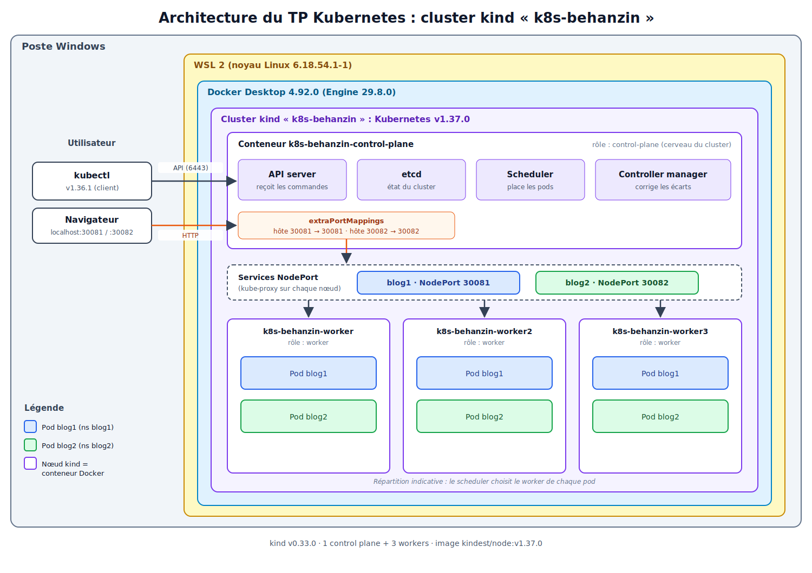

# Partie 1 — Cluster bac à sable `k8s-behanzin`

> **Auteur :** Perceval BEHANZIN
> **TP :** Kubernetes Niveau 1 — AUKFOOD
> **Date de réalisation :** 21/10/2026

## Sommaire

1. [Choix de la solution](#1-choix-de-la-solution)
2. [Prérequis](#2-prérequis)
3. [Procédure d'installation](#3-procédure-dinstallation)
4. [Schéma d'architecture](#4-schéma-darchitecture)
5. [Vérifications](#5-vérifications)
6. [Difficultés rencontrées](#6-difficultés-rencontrées)

---

## 1. Choix de la solution
J'ai choisi **kind** car le TP demande un cluster de 4 nœuds
(1 control plane + 3 workers). kind permet de décrire cette topologie dans un
fichier `kind-config.yaml` versionné, de recréer le cluster à l’identique en
une commande, et consomme peu de ressources


## Comparaison des solutions de mise en place d’un cluster

Pour un cluster Kubernetes local, plusieurs outils existent. Les deux plus
utilisés sont **kind** et **minikube**.

### Solution 1 : kind (Kubernetes IN Docker)

kind crée chaque nœud Kubernetes sous forme de conteneur Docker. Il a été
conçu à l’origine par la communauté Kubernetes pour tester Kubernetes
lui-même.

- **Avantages** : création très rapide (environ une minute), multi-nœuds
  simple à déclarer dans un fichier YAML, léger (seul Docker est nécessaire),
  configuration versionnable et reproductible.
- **Inconvénients** : les services ne sont pas accessibles depuis l’hôte sans
  configurer `extraPortMappings`, pas de tableau de bord ni d’extensions
  intégrées, nécessite Docker.

### Solution 2 : minikube

minikube crée un cluster dans une machine virtuelle ou un conteneur, selon le
« driver » choisi (Docker, Hyper-V, VirtualBox…).

- **Avantages** : très accessible aux débutants, nombreux addons activables en
  une commande (`minikube addons enable dashboard`, `ingress`…), commande
  `minikube service` qui ouvre directement un service dans le navigateur.
- **Inconvénients** : un seul nœud par défaut (le multi-nœuds existe avec
  `--nodes` mais reste moins naturel), plus gourmand en ressources avec un
  driver de VM, démarrage plus lent.

### Tableau comparatif

| Critère                  | kind                         | minikube                          |
|--------------------------|------------------------------|-----------------------------------|
| Technologie              | Nœuds = conteneurs Docker    | VM ou conteneur selon le driver   |
| Multi-nœuds              | Natif, via le fichier YAML   | Possible avec `--nodes`           |
| Rapidité de création     | Très rapide                  | Plus lent                         |
| Consommation ressources  | Faible                       | Moyenne à élevée (VM)             |
| Accès aux services       | `extraPortMappings` à prévoir | `minikube service` intégré        |
| Extensions (dashboard…)  | À installer soi-même         | Addons intégrés                   |
| Usage typique            | Tests, CI, TP multi-nœuds    | Découverte, développement local   |


### Justification du choix

Je travaille sur un PC portable Windows 10 Professionnel (Dell Latitude E7440, processeur Intel Core i7 de 4e génération, 16 Go de RAM) sur lequel Docker Desktop est installé. kind réutilise directement Docker : chaque nœud du cluster est un conteneur, il n'y a donc ni hyperviseur ni machines virtuelles supplémentaires à installer. Un cluster de 4 nœuds avec kubeadm demanderait 4 VM d'environ 2 Go de RAM chacune, soit la moitié de la mémoire de mon poste avant même de déployer les blogs. Avec kind, les 4 nœuds partagent la mémoire de Docker et ne consomment que ce dont ils ont besoin. VirtualBox et VMware sont aussi installés sur mon poste, donc la solution kubeadm sur VM était techniquement possible, mais une fois le cluster kind démarré il ne me restait déjà que 5,8 Go de RAM libre : 4 VM complètes n'auraient pas tenu.

J'ai aussi envisagé le Kubernetes intégré à Docker Desktop, qui propose maintenant un mode kind avec plusieurs nœuds. Je l'ai écarté parce que le cluster s'appelle obligatoirement `docker-desktop` : il est impossible de le nommer `k8s-behanzin` comme l'exige le TP. Il ne permet pas non plus de publier les NodePorts sur Windows, ce qui aurait empêché d'ouvrir les blogs dans le navigateur. Enfin, sa configuration se fait par des curseurs dans l'interface graphique, ce qui est difficile à documenter de façon reproductible.

Avec kind en ligne de commande, tout le cluster est décrit dans un seul fichier, `kind-config.yaml` : le nom, le nombre de nœuds, leur rôle et les ports publiés. N'importe qui peut recréer exactement le même cluster avec une seule commande. La limite que j'accepte est que les nœuds sont des conteneurs et non de vraies machines, ce qui est moins proche de la production qu'un cluster kubeadm sur VM. Pour un cluster bac à sable, c'est le meilleur compromis entre ressources, simplicité et fidélité à Kubernetes, puisque kind installe les vrais composants (kubeadm, etcd, API server, kubelet…).

---

## 2. Prérequis

### Machine hôte

| Élément | Valeur |
|---|---|
| Machine | Dell Latitude E7440 (BIOS Dell A28) |
| Système | Windows 10 Professionnel 22H2, 64 bits (build 10.0.19045.6466) |
| CPU | Intel Core i7 de 4e génération (Haswell — Intel64 Family 6 Model 69), ~2,0 GHz |
| RAM | 16 Go (16 289 Mo) |
| Disque | SSD 256 Go (59 Go libres au moment de l'installation) |
| Virtualisation | Activée : un hyperviseur est détecté (nécessaire pour WSL 2) |
| Autres hyperviseurs présents | VMware Workstation (VMnet1) et VirtualBox (réseau host-only 192.168.56.1) |
| Réseau WSL | Carte `vEthernet (WSL)` : 172.26.80.1 |

Extrait de `systeminfo` (lignes utiles) :

```
C:\Users\DUP>systeminfo
Nom du système d'exploitation:              Microsoft Windows 10 Professionnel
Version du système:                         10.0.19045 N/A build 19045
Fabricant du système:                       Dell Inc.
Modèle du système:                          Latitude E7440
Type du système:                            x64-based PC
Processeur(s):                              1 processeur(s) installé(s).
                                            [01] : Intel64 Family 6 Model 69 Stepping 1 GenuineIntel ~2000 MHz
Version du BIOS:                            Dell Inc. A28, 13/06/2019
Mémoire physique totale:                    16 289 Mo
Mémoire physique disponible:                5 833 Mo
Mémoire virtuelle : taille maximale:        23 897 Mo
Mémoire virtuelle : disponible:             2 740 Mo
Mémoire virtuelle : en cours d'utilisation: 21 157 Mo
Configuration requise pour Hyper-V:         Un hyperviseur a été détecté. Les fonctionnalités nécessaires à Hyper-V ne seront pas affichées.
```

Commentaire :

- « Intel64 Family 6 Model 69 » correspond à un processeur Intel de la génération Haswell (2013), dans sa version basse consommation pour portables.
- La ligne « Un hyperviseur a été détecté » confirme que la virtualisation est active : c'est l'hyperviseur utilisé par WSL 2, donc par Docker Desktop.
- Au moment du relevé, avec le cluster kind démarré, il ne restait que **5,8 Go de RAM physique libre** sur 16 Go. Les 4 nœuds kind, Docker Desktop et WSL 2 consomment donc déjà une part importante de la mémoire, ce qui confirme qu'un cluster de 4 VM complètes (kubeadm) aurait été trop lourd pour ce poste.
- Les blogs seront joints sur `localhost` (ports publiés par Docker) et non sur une adresse du réseau VirtualBox `192.168.56.x` comme dans l'exemple du sujet, car le cluster ne tourne pas dans des VM VirtualBox.

### Logiciels installés

| Logiciel           | Version                                               | Commande de vérification | Rôle                                                       |
|:-------------------|:------------------------------------------------------|:-------------------------|:-----------------------------------------------------------|
| **WSL**            | `3.0.3.0` (noyau Linux `6.18.54.1-1`)                 | `wsl --version`          | Machine Linux légère dans laquelle tourne Docker           |
| **Docker Desktop** | `4.92.0` (Docker Engine `29.8.0`, containerd `v2.3.5`) | `docker version`         | Moteur de conteneurs : chaque nœud kind est un conteneur   |
| **kind**           | `v0.33.0` (go1.26.7, windows/amd64)                   | `kind version`           | Création du cluster Kubernetes dans Docker                 |
| **kubectl**        | `v1.36.1` (client)                                    | `kubectl version`        | Client en ligne de commande pour piloter le cluster        |
| **Image des nœuds** | `kindest/node:v1.37.0`                               | `kubectl get nodes`      | Kubernetes `v1.37.0` dans chaque nœud                      |

> **Compatibilité des versions**
 kubectl (`v1.36`) et le cluster (`v1.37`) n’ont qu’une version mineure d’écart. Cette combinaison est supportée : Kubernetes tolère un écart de ±1 version mineure entre le client et le serveur.

### Sorties des commandes de version

```
C:\Users\DUP\Documents\tp-k8s-behanzin>wsl --version
Version WSL : 3.0.3.0
Version du noyau : 6.18.54.1-1
Version WSLg : 1.0.79
Version MSRDC : 1.2.7391
Version direct3D : 1.611.1-81528511
Version de DXCore : 10.0.26100.1-240331-1435.ge-release
Version de Windows : 10.0.19045.6466
```

```
C:\Users\DUP\Documents\tp-k8s-behanzin>docker version
Client:
 Version:           29.8.0
 API version:       1.56
 Go version:        go1.26.8
 Git commit:        88096ef
 Built:             Thu Sep  3 21:53:38 2026
 OS/Arch:           windows/amd64
 Context:           desktop-linux

Server: Docker Desktop 4.92.0 (240144)
 Engine:
  Version:          29.8.0
  API version:      1.56 (minimum version 1.40)
  Go version:       go1.26.8
  Git commit:       3ce5872
  Built:            Thu Sep  3 21:51:20 2026
  OS/Arch:          linux/amd64
  Experimental:     false
 containerd:
  Version:          v2.3.5
  GitCommit:        1294c24a7da8e5a793ed378161673abe94118892
 runc:
  Version:          1.5.1
  GitCommit:        v1.5.1-0-g8f2685a4
 docker-init:
  Version:          0.19.0
  GitCommit:        de40ad0
```


Le client Docker tourne sous Windows (`windows/amd64`), alors que le serveur (Engine) tourne sous Linux (`linux/amd64`) dans WSL 2.

```
C:\Users\DUP\Documents\tp-k8s-behanzin>kind version
kind v0.33.0 go1.26.7 windows/amd64

C:\Users\DUP\Documents\tp-k8s-behanzin>kubectl version --client
Client Version: v1.36.1
Kustomize Version: v5.8.1
```

---

## 3. Procédure d'installation

Toutes les commandes sont lancées dans l'invite de commandes Windows (`cmd`).

### 3.1 Activer WSL 2

Docker Desktop a besoin d'une distribution Linux gérée par WSL 2 pour faire tourner ses conteneurs. Dans un terminal **administrateur** :

```
wsl --install
```

Redémarrer le PC, puis vérifier :

```
wsl --version
```

### 3.2 Installer Docker Desktop

1. Télécharger l'installateur sur https://www.docker.com/products/docker-desktop/ et l'exécuter.
2. Lancer Docker Desktop et accepter les conditions d'utilisation.
3. Vérifier les réglages suivants (*Settings*) :

Docker utilise le moteur Linux de WSL 2 
le cluster est créé avec kind en ligne de commande 


 **Pourquoi ne pas activer le Kubernetes de Docker Desktop ?**
  Docker Desktop propose son propre cluster Kubernetes à un seul nœud. Le laisser activé ferait tourner deux clusters en parallèle (consommation de ressources inutile) et ajouterait un contexte `docker-desktop` dans kubectl, avec le risque de lancer des commandes sur le mauvais cluster. Le cluster du TP est uniquement celui créé par kind (contexte `kind-k8s-behanzin`).

### 3.3 Installer kind et kubectl

```
winget install -e --id Kubernetes.kind
winget install -e --id Kubernetes.kubectl
```

- `winget` est le gestionnaire de paquets intégré à Windows.
- `-e` (*exact*) installe exactement le paquet nommé.
- Docker Desktop fournit déjà un kubectl. La deuxième commande n'est utile que si `kubectl version --client` ne répond pas.

Fermer puis rouvrir le terminal pour recharger le PATH, puis vérifier :

```
docker version
kind version
kubectl version --client
```


### 3.4 Créer le dossier du projet

```
C:\Users\DUP\Documents\tp-k8s-behanzin>tree
Structure du dossier
Le numéro de série du volume est 0E7F-D5E3
C:.
├───1-cluster
│   ├───captures
│   └───config
└───2-application
    ├───captures
    └───manifests
        ├───blog1
        └───blog2

```
### 3.5 Écrire le fichier de configuration

```
notepad 1-cluster\config\kind-config.yaml
```

Contenu du fichier `1-cluster/config/kind-config.yaml` :

```yaml
# Configuration kind : 1 control plane + 3 workers
kind: Cluster                          # type d'objet décrit : un cluster kind
apiVersion: kind.x-k8s.io/v1alpha4     # version du format de configuration kind
name: k8s-behanzin                     # nom du cluster imposé par le TP
nodes:                                 # chaque entrée = un conteneur Docker = un nœud
  - role: control-plane                # nœud maître : API server, etcd, scheduler, controller-manager
    # Les nœuds kind sont des conteneurs Docker : on publie sur l'hôte
    # les NodePorts des futurs blogs pour les ouvrir dans le navigateur.
    extraPortMappings:
      - containerPort: 30081           # NodePort du blog 1 dans le conteneur nœud
        hostPort: 30081                # port ouvert sur Windows -> http://localhost:30081
      - containerPort: 30082           # NodePort du blog 2
        hostPort: 30082                # -> http://localhost:30082
  - role: worker                       # nœuds qui exécutent les applications
  - role: worker
  - role: worker
```


Vérifier que le fichier existe sous le bon nom (et pas en `.txt`) :

```
C:\Users\DUP\Documents\tp-k8s-behanzin\1-cluster\config>dir
 Répertoire de C:\Users\DUP\Documents\tp-k8s-behanzin\1-cluster\config

21/10/2026  10:54    <DIR>          .
21/10/2026  10:54    <DIR>          ..
21/10/2026  10:56               561 kind-config.yaml
               1 fichier(s)              561 octets
```

### 3.6 Créer le cluster

Docker Desktop doit être démarré. La commande doit être lancée **depuis la racine du projet** (`tp-k8s-behanzin`), car le chemin du fichier est relatif :

```
C:\Users\DUP\Documents\tp-k8s-behanzin>kind create cluster --config 1-cluster\config\kind-config.yaml
Creating cluster "k8s-behanzin" ...
 ✓ Ensuring node image (kindest/node:v1.37.0) 🖼️
 ✓ Preparing nodes 📦 📦 📦 📦
 ✓ Writing configuration 📜
 ✓ Starting control-plane 🕹️
 ✓ Installing CNI 🔌
 ✓ Installing StorageClass 💾
 ✓ Joining worker nodes 🚜
Set kubectl context to "kind-k8s-behanzin"
You can now use your cluster with:



kubectl cluster-info --context kind-k8s-behanzin

Thanks for using kind! 😊
```

Chaque ligne correspond à une étape de la création :

| Étape | Ce qui se passe |
|---|---|
| Ensuring node image | Téléchargement de l'image `kindest/node:v1.37.0`, qui contient Kubernetes v1.37.0, containerd et le kubelet |
| Preparing nodes | Création des 4 conteneurs Docker (les 4 📦 = 4 nœuds) |
| Writing configuration | Génération de la configuration kubeadm de chaque nœud |
| Starting control-plane | `kubeadm init` sur le control plane : démarrage d'etcd, de l'API server, du scheduler et du controller-manager |
| Installing CNI | Installation du plugin réseau kindnet |
| Installing StorageClass | Installation d'un stockage par défaut (utile pour les volumes persistants) |
| Joining worker nodes | `kubeadm join` : les 3 workers rejoignent le cluster |
| Set kubectl context | Ajout du contexte `kind-k8s-behanzin` dans `%USERPROFILE%\.kube\config` |

### 3.7 Vérifier le contexte et les nœuds Docker

```
C:\Users\DUP\Documents\tp-k8s-behanzin>kubectl config current-context
kind-k8s-behanzin
```

kubectl est bien connecté au cluster `k8s-behanzin`.

```
C:\Users\DUP\Documents\tp-k8s-behanzin>docker ps
CONTAINER ID   IMAGE                  COMMAND                  CREATED          STATUS          PORTS                                                             NAMES
2f088d5b2bed   kindest/node:v1.37.0   "/usr/local/bin/entr…"   16 minutes ago   Up 15 minutes   0.0.0.0:30081-30082->30081-30082/tcp, 127.0.0.1:64645->6443/tcp   k8s-behanzin-control-plane
518d6b915479   kindest/node:v1.37.0   "/usr/local/bin/entr…"   16 minutes ago   Up 15 minutes                                                                     k8s-behanzin-worker3
1495bdf38302   kindest/node:v1.37.0   "/usr/local/bin/entr…"   16 minutes ago   Up 16 minutes                                                                     k8s-behanzin-worker2
f5b79fc6dd9f   kindest/node:v1.37.0   "/usr/local/bin/entr…"   16 minutes ago   Up 16 minutes                                                                     k8s-behanzin-worker
```

Commentaire :

- Les **4 conteneurs** sont les 4 nœuds du cluster : 1 control plane et 3 workers, tous basés sur l'image `kindest/node:v1.37.0`.
- Seul le control plane publie des ports sur Windows :
  - `127.0.0.1:64645->6443` : l'API server écoute sur le port 6443 dans le conteneur. Docker le rend accessible sur Windows au port 64645, choisi au hasard par kind. C'est par là que passe kubectl.
  - `0.0.0.0:30081-30082->30081-30082` : ce sont les `extraPortMappings` du fichier de configuration, qui serviront à ouvrir les blogs sur `http://localhost:30081` et `http://localhost:30082`.
- Publier les NodePorts sur le seul control plane suffit : kube-proxy ouvre un NodePort sur **tous** les nœuds, même si le pod tourne sur un worker.

### 3.8 Reproductibilité : figer les versions

La version de Kubernetes dépend de la version de kind : kind v0.33.0 utilise par défaut l'image `kindest/node:v1.37.0`. Pour obtenir exactement le même cluster avec une autre version de kind, on peut imposer l'image en ajoutant sous chaque nœud du fichier de configuration :

```yaml
    image: kindest/node:v1.37.0
```

ou en passant l'option à la création :

```
kind create cluster --config 1-cluster\config\kind-config.yaml --image kindest/node:v1.37.0
```

### 3.9 Supprimer le cluster

```
kind delete cluster --name k8s-behanzin
```

Cette commande supprime les 4 conteneurs et le contexte `kind-k8s-behanzin` du kubeconfig. Le cluster peut être recréé à l'identique en reprenant l'étape 3.6.

---

## 4. Schéma d'architecture

## Schéma d'architecture



```

### Explication du schéma

Le schéma se lit de l’extérieur vers l’intérieur, comme des boîtes
imbriquées.

**Les couches d’infrastructure.** Le cluster tourne sur un poste
Windows. Windows ne pouvant pas exécuter directement des conteneurs
Linux, Docker Desktop s’appuie sur **WSL 2**, une machine Linux légère
intégrée à Windows. Dans Docker, l’outil **kind** crée le cluster
Kubernetes `k8s-behanzin` : chaque nœud du cluster est en réalité un
simple conteneur Docker (4 conteneurs au total).

**Le control plane.** Le premier nœud, `k8s-behanzin-control-plane`, est
le cerveau du cluster. Il ne fait pas tourner les applications mais
contient les composants qui les gèrent :

- l’**API server**, point d’entrée unique qui reçoit toutes les commandes ;
- **etcd**, la base de données qui mémorise l’état du cluster ;
- le **scheduler**, qui choisit sur quel worker placer chaque pod ;
- le **controller manager**, qui compare en permanence l’état voulu et
  l’état réel, et corrige les écarts (par exemple en recréant un pod
  arrêté).

**Les workers.** Les trois nœuds `worker`, `worker2` et `worker3`
exécutent les pods des applications. Les pods du blog 1 (en bleu) et du
blog 2 (en vert) sont répartis entre eux par le scheduler ; la
répartition dessinée est indicative.

**Les deux chemins d’accès.**

1. *Administration (flèche noire)* : depuis Windows, `kubectl` envoie
   ses commandes à l’API server (port 6443) pour créer, consulter ou
   supprimer des ressources.
2. *Accès aux blogs (flèche orange)* : les nœuds étant des conteneurs,
   ils ne sont pas joignables directement depuis Windows. Les
   `extraPortMappings` du fichier `kind-config.yaml` relient les ports
   30081 et 30082 de l’hôte à ceux du control plane. Une requête vers
   `http://localhost:30081` arrive donc dans le cluster, où le
   **Service NodePort** du blog 1 la redirige, grâce à kube-proxy
   présent sur chaque nœud, vers un pod du blog 1, quel que soit le
   worker qui l’héberge. Le même mécanisme s’applique au blog 2 sur le
   port 30082.

## 5. Vérifications

Commandes lancées le 21/10/2026 depuis la racine du projet, environ 2 h 50 après la création du cluster.

### 5.1 `kubectl cluster-info`

```
C:\Users\DUP\Documents\tp-k8s-behanzin>kubectl cluster-info
Kubernetes control plane is running at https://127.0.0.1:64645
CoreDNS is running at https://127.0.0.1:64645/api/v1/namespaces/kube-system/services/kube-dns:dns/proxy

To further debug and diagnose cluster problems, use 'kubectl cluster-info dump'.
```

Commentaire :

- **L'API server répond** : le cluster est joignable et kubectl est correctement configuré.
- L'adresse `https://127.0.0.1:64645` correspond exactement au port publié par Docker dans `docker ps` (section 3.7) : `127.0.0.1:64645->6443/tcp`. L'API server écoute sur le port 6443 à l'intérieur du conteneur `k8s-behanzin-control-plane`, et Docker le rend accessible sur Windows au port 64645. Ce port n'est ouvert que sur `127.0.0.1`, donc l'API n'est pas exposée sur le réseau.
- **CoreDNS**, le DNS interne du cluster, est actif. Il permettra aux pods de joindre les Services par leur nom, par exemple `ghost.behanzin-blog2.svc.cluster.local` dans la partie 2.

### 5.2 `kubectl get nodes -o wide`

```
C:\Users\DUP\Documents\tp-k8s-behanzin>kubectl get nodes -o wide
NAME                         STATUS   ROLES           AGE    VERSION   INTERNAL-IP   EXTERNAL-IP   OS-IMAGE                       KERNEL-VERSION                              CONTAINER-RUNTIME
k8s-behanzin-control-plane   Ready    control-plane   170m   v1.37.0   172.18.0.5    <none>        Debian GNU/Linux 13 (trixie)   6.18.54.1-microsoft-standard-WSL2 (amd64)   containerd://2.3.4
k8s-behanzin-worker          Ready    <none>          169m   v1.37.0   172.18.0.2    <none>        Debian GNU/Linux 13 (trixie)   6.18.54.1-microsoft-standard-WSL2 (amd64)   containerd://2.3.4
k8s-behanzin-worker2         Ready    <none>          169m   v1.37.0   172.18.0.3    <none>        Debian GNU/Linux 13 (trixie)   6.18.54.1-microsoft-standard-WSL2 (amd64)   containerd://2.3.4
k8s-behanzin-worker3         Ready    <none>          169m   v1.37.0   172.18.0.4    <none>        Debian GNU/Linux 13 (trixie)   6.18.54.1-microsoft-standard-WSL2 (amd64)   containerd://2.3.4
```

Commentaire :

| Colonne | Constat | Explication |
|---|---|---|
| `NAME` | `k8s-behanzin-control-plane`, `-worker`, `-worker2`, `-worker3` | **1 control plane et 3 workers**, comme demandé. Le préfixe `k8s-behanzin` respecte la règle de personnalisation |
| `STATUS` | **4 × `Ready`** | Chaque kubelet communique avec l'API server et le réseau (kindnet) est opérationnel : les nœuds peuvent recevoir des pods |
| `ROLES` | `control-plane` pour le maître, `<none>` pour les workers | Normal : Kubernetes n'affiche que le rôle control-plane ; un nœud sans rôle affiché est un worker |
| `AGE` | 170 min et 169 min | Le control plane a été créé en premier, puis les workers l'ont rejoint (étape « Joining worker nodes ») |
| `VERSION` | `v1.37.0` partout | Version de Kubernetes apportée par l'image `kindest/node:v1.37.0` ; tous les nœuds sont dans la même version |
| `INTERNAL-IP` | `172.18.0.2` à `172.18.0.5` | Adresses des 4 conteneurs dans le réseau Docker `kind` (172.18.0.0/16). C'est par ce réseau que les nœuds communiquent entre eux |
| `EXTERNAL-IP` | `<none>` | Pas d'IP publique : le cluster est local, on y accède par les ports publiés sur `localhost` |
| `OS-IMAGE` | `Debian GNU/Linux 13 (trixie)` | Le système **à l'intérieur** de chaque nœud. Mon PC est sous Windows, mais les nœuds sont des conteneurs Linux |
| `KERNEL-VERSION` | `6.18.54.1-microsoft-standard-WSL2` | C'est le **même noyau** que celui de WSL 2 (`wsl --version` : 6.18.54.1). Les nœuds n'ont pas leur propre noyau : ce sont des conteneurs qui partagent le noyau de la machine Linux de WSL 2, contrairement à des VM |
| `CONTAINER-RUNTIME` | `containerd://2.3.4` | Chaque nœud a son **propre containerd**, qui démarre les conteneurs des pods. Il est différent de celui de Docker Desktop (v2.3.5 dans `docker version`), qui lui fait tourner les conteneurs-nœuds eux-mêmes |

**Conclusion : le cluster comporte bien 1 control plane et 3 workers, tous `Ready`.**

### 5.3 `kubectl get pods -n kube-system -o wide`

```
C:\Users\DUP\Documents\tp-k8s-behanzin>kubectl get pods -n kube-system -o wide
NAME                                                 READY   STATUS    RESTARTS      AGE    IP           NODE                         NOMINATED NODE   READINESS GATES
coredns-559f6c778d-2jxm8                             1/1     Running   1 (45m ago)   170m   10.244.0.4   k8s-behanzin-control-plane   <none>           <none>
coredns-559f6c778d-54zlq                             1/1     Running   1 (45m ago)   170m   10.244.0.3   k8s-behanzin-control-plane   <none>           <none>
etcd-k8s-behanzin-control-plane                      1/1     Running   0             170m   172.18.0.5   k8s-behanzin-control-plane   <none>           <none>
kindnet-2gcfv                                        1/1     Running   0             169m   172.18.0.4   k8s-behanzin-worker3         <none>           <none>
kindnet-5rdcb                                        1/1     Running   0             169m   172.18.0.3   k8s-behanzin-worker2         <none>           <none>
kindnet-8ggnq                                        1/1     Running   0             169m   172.18.0.2   k8s-behanzin-worker          <none>           <none>
kindnet-s55tw                                        1/1     Running   0             170m   172.18.0.5   k8s-behanzin-control-plane   <none>           <none>
kube-apiserver-k8s-behanzin-control-plane            1/1     Running   3 (39m ago)   170m   172.18.0.5   k8s-behanzin-control-plane   <none>           <none>
kube-controller-manager-k8s-behanzin-control-plane   1/1     Running   4 (36m ago)   170m   172.18.0.5   k8s-behanzin-control-plane   <none>           <none>
kube-proxy-q97lh                                     1/1     Running   0             169m   172.18.0.2   k8s-behanzin-worker          <none>           <none>
kube-proxy-qlcl8                                     1/1     Running   0             170m   172.18.0.5   k8s-behanzin-control-plane   <none>           <none>
kube-proxy-r5rfw                                     1/1     Running   0             169m   172.18.0.4   k8s-behanzin-worker3         <none>           <none>
kube-proxy-sxpq4                                     1/1     Running   0             169m   172.18.0.3   k8s-behanzin-worker2         <none>           <none>
kube-scheduler-k8s-behanzin-control-plane            1/1     Running   3 (36m ago)   170m   172.18.0.5   k8s-behanzin-control-plane   <none>           <none>
```

On retrouve dans `kube-system` tous les composants du schéma de la section 4 :

Observations sur les adresses IP :

- Les composants du control plane, kube-proxy et kindnet ont pour IP **l'adresse de leur nœud** (`172.18.0.x`) : ils utilisent directement le réseau du nœud (*hostNetwork*), car ils en ont besoin pour configurer le nœud lui-même.
- Les pods CoreDNS ont des IP en **`10.244.0.x`** : c'est le réseau des pods géré par kindnet (10.244.0.0/16). Chaque nœud reçoit une tranche, `10.244.0.0/24` pour le control plane. Les pods de la partie 2 recevront aussi une IP de ce réseau.

Tous les pods sont **`Running` et `1/1` (READY)** : le cluster est opérationnel.

Remarques :

- Le **kubelet** n'apparaît pas dans la liste : ce n'est pas un pod, mais un service système qui tourne directement dans chaque nœud.
- La colonne `RESTARTS` montre des redémarrages il y a 36 à 45 minutes (kube-apiserver 3, kube-controller-manager 4, kube-scheduler 3, coredns 1). Ils sont analysés dans la section 6. Ils ne concernent pas etcd (0 redémarrage) : les données du cluster n'ont pas été affectées, et Kubernetes a relancé seul les composants, qui fonctionnent normalement depuis.


---

## 6. Difficultés rencontrées

### 1. Docker Desktop ne démarrait pas

Après son installation, Docker Desktop refusait de démarrer. La cause
venait du fonctionnement de Docker sous Windows : les conteneurs Linux
ne peuvent pas s’exécuter directement sur Windows, Docker Desktop a donc
besoin de **WSL 2**, une machine Linux légère intégrée au système, qui
n’était pas installée. J’ai installé WSL 2 avec la commande
`wsl --install`, puis redémarré le PC. Docker Desktop a ensuite démarré
normalement.

### 2. La commande kind n’était pas reconnue

Au premier lancement de kind, le terminal a affiché l’erreur
`'kind' n’est pas reconnu en tant que commande interne…`. kind n’était
tout simplement pas installé, et Windows ne trouvait donc aucun
exécutable de ce nom dans le `PATH`. Je l’ai installé avec
`winget install Kubernetes.kind`, puis j’ai fermé et rouvert le terminal
afin qu’il recharge le `PATH` et prenne en compte la nouvelle commande.

### 3. Le choix entre Kubernetes de Docker Desktop et kind

Docker Desktop propose d’activer son propre cluster Kubernetes, ce qui
semblait être la solution la plus simple. Je l’ai écartée car elle ne
répondait pas aux exigences du TP : ce cluster ne comporte qu’un seul
nœud, son nom est imposé (`docker-desktop`) et il ne permet pas de
publier les NodePorts comme le fait kind. J’ai donc laissé cette option
désactivée et créé le cluster avec kind en ligne de commande, ce qui
m’a permis d’obtenir les quatre nœuds demandés et de choisir le nom du
cluster.