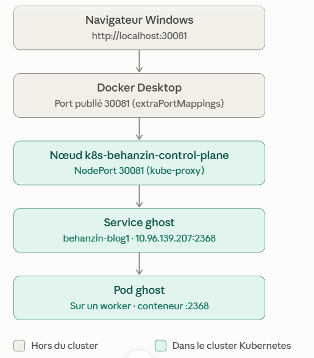
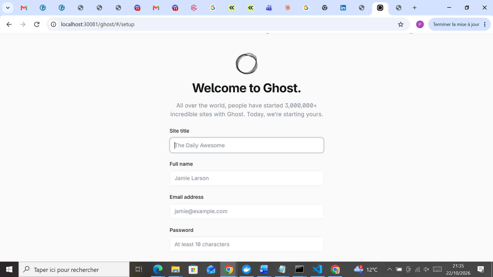
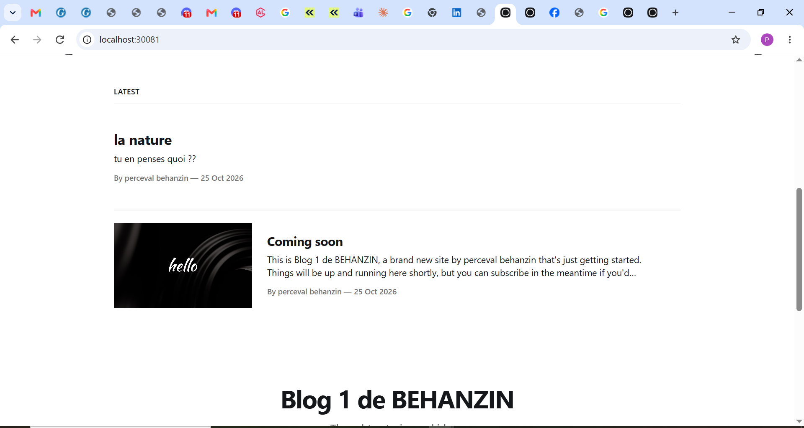
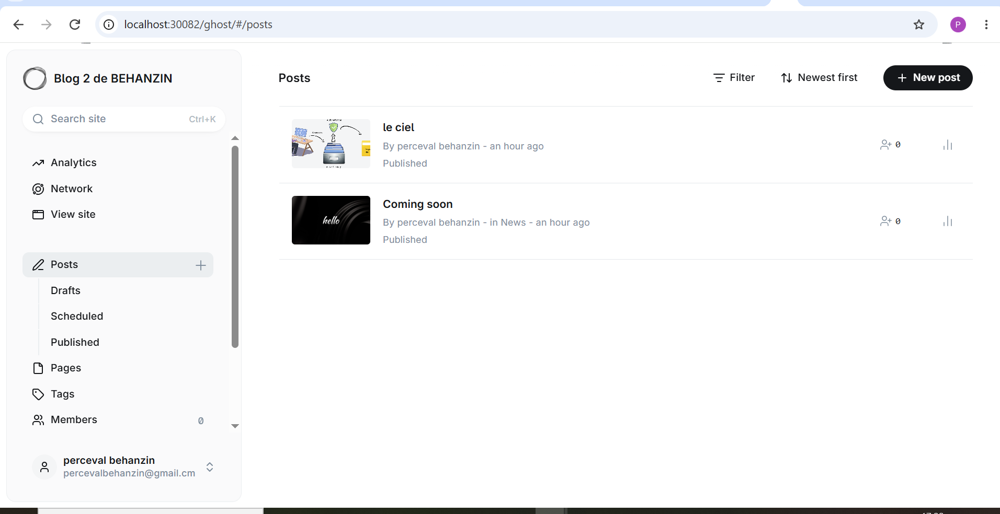
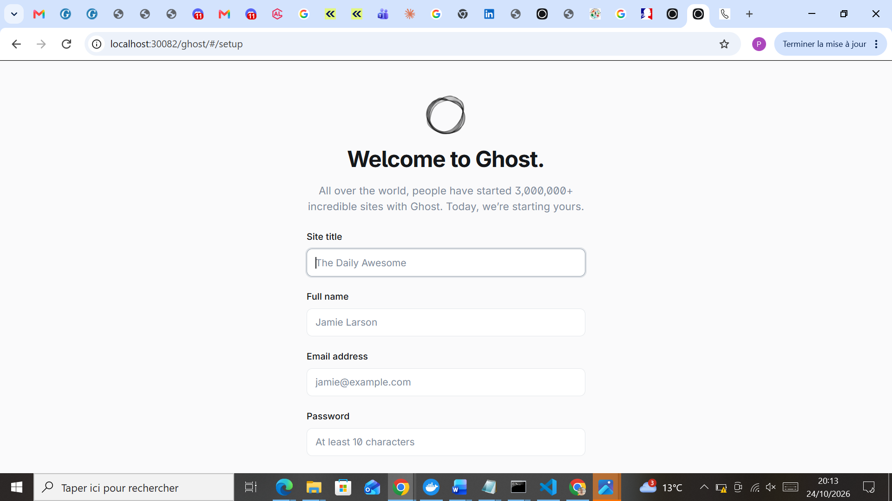
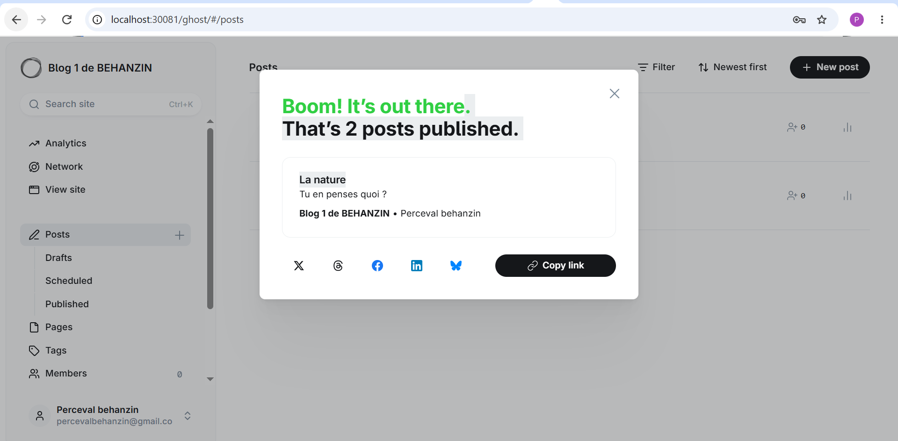
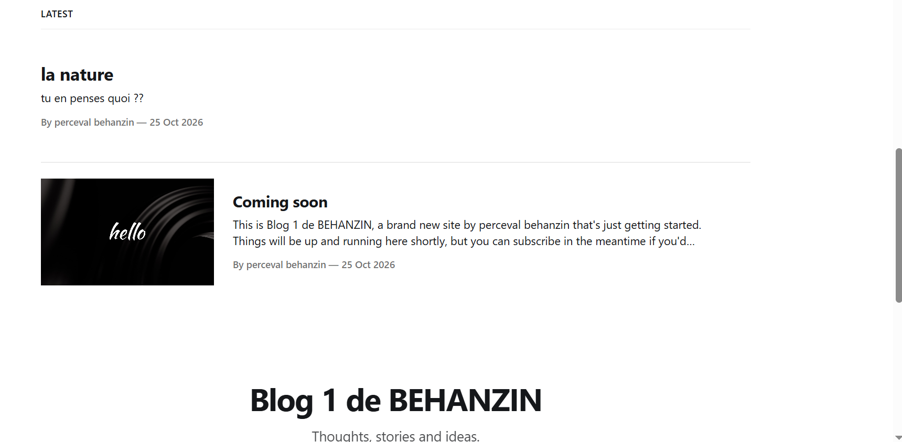

# Partie 2 — Déploiement de deux blogs Ghost isolés

> **Auteur :** Perceval BEHANZIN — TP Kubernetes Niveau 1
> **Cluster :** `k8s-behanzin` (kind, 1 control plane + 3 workers, voir [Partie 1](../1-cluster/cluster.md))

## Sommaire

1. [Vue d'ensemble](#1-vue-densemble)
2. [Manifestes](#2-manifestes)
3. [Procédure de déploiement](#3-procédure-de-déploiement)
4. [Configuration des blogs](#4-configuration-des-blogs)
5. [Preuves de fonctionnement en console](#5-preuves-de-fonctionnement-en-console)
6. [Preuve de fonctionnement web](#6-preuve-de-fonctionnement-web)
7. [Isolation des namespaces](#7-isolation-des-namespaces)
8. [Questions](#8-questions)
9. [Suppression](#9-suppression)
10. [Difficultés rencontrées](#10-difficultés-rencontrées)

---

## 1. Vue d'ensemble

| | Blog 1 | Blog 2 |
|---|---|---|
| Namespace | `behanzin-blog1` | `behanzin-blog2` |
| Deployment | `ghost` (1 réplica, image `ghost:6-alpine`) | `ghost` (1 réplica, image `ghost:6-alpine`) |
| Service | `ghost`, type NodePort, ClusterIP `10.96.139.207` | `ghost`, type NodePort, ClusterIP `10.96.156.75` |
| nodePort | `30081` | `30082` |
| URL (variable `url`) | http://localhost:30081 | http://localhost:30082 |
| Titre du site | Blog 1 de behanzin | Blog 2 de behanzin |
| Base de données | SQLite dans le conteneur | SQLite dans le conteneur |

Chemin d'une requête depuis le navigateur :



---

## 2. Manifestes

Les manifestes sont dans `manifests/blog1/` et `manifests/blog2/`. Chaque fichier est commenté ligne par ligne. Les deux blogs sont identiques, à trois différences près : le nom du namespace (et le label `blog`), le `nodePort` et la variable `url`.

| Fichier | Objet | Rôle |
|---|---|---|
| `01-namespace.yaml` | Namespace | Espace isolé qui contient toutes les ressources du blog |
| `02-deployment.yaml` | Deployment | Maintient 1 Pod Ghost en fonctionnement, avec ses ressources et sa configuration |
| `03-service.yaml` | Service NodePort | Adresse stable devant le Pod, et port ouvert sur les nœuds pour l'accès externe |

Les fichiers sont numérotés car `kubectl apply -f <dossier>` les traite par ordre alphabétique : le namespace doit exister avant le Deployment et le Service qu'il contient.

### Choix des valeurs

| Paramètre | Valeur | Justification |
|---|---|---|
| `replicas` | 1 | SQLite est un fichier local au Pod : plusieurs réplicas auraient chacun leur propre base (voir question 1) |
| `selector` / labels | `app: ghost`, `blog: blog1` | Le Deployment et le Service retrouvent leur Pod grâce à ces labels |
| `owner` | `behanzin` | Règle de personnalisation du TP, présente sur le Namespace, le Deployment, les Pods et le Service |
| `NODE_ENV` | `development` | Dans ce mode, Ghost utilise une base SQLite embarquée : aucun serveur MySQL n'est nécessaire |
| `url` | `http://localhost:30081` | Adresse exacte utilisée dans le navigateur. Ghost l'utilise pour générer ses liens ; une valeur différente casserait les redirections et l'interface d'administration |
| `requests` | 100m CPU, 256 Mio | Ressources réservées pour placer le Pod sur un nœud qui a de la place, sans surcharger un poste limité en RAM |
| `limits` | 1 CPU, 768 Mio | Plafonds : Ghost consomme beaucoup de CPU au démarrage et 300 à 500 Mio de mémoire en fonctionnement. Au-delà de 768 Mio, le conteneur serait tué (OOMKilled) |
| `nodePort` | 30081 / 30082 | Un port différent par blog, dans la plage 30000-32767, et identique aux ports publiés par kind (`extraPortMappings`) |

Comme les `requests` sont inférieures aux `limits`, Kubernetes classe le Pod dans la **classe de QoS `Burstable`** (visible dans `kubectl describe pod`) : il a un minimum garanti et peut consommer davantage si le nœud a des ressources libres.

---

## 3. Procédure de déploiement

Toutes les commandes sont lancées dans `cmd`, depuis la racine du projet `C:\Users\DUP\Documents\tp-k8s-behanzin`, avec le contexte `kind-k8s-behanzin` actif (`kubectl config current-context`).

### 3.1 Déployer le blog 1

```
C:\Users\DUP\Documents\tp-k8s-behanzin>kubectl apply -f 2-application\manifests\blog1
namespace/behanzin-blog1 created
deployment.apps/ghost created
service/ghost created
```

Les trois objets sont créés dans l'ordre des fichiers : d'abord le namespace, puis le Deployment et le Service qui y sont rattachés.

### 3.2 Suivre le démarrage du Pod

```
kubectl describe pod -n behanzin-blog1
```

Juste après le déploiement, le Pod est en attente :

```
Name:             ghost-79855d4885-tlrtp
Namespace:        behanzin-blog1
Node:             k8s-behanzin-worker3/172.18.0.4
Start Time:       Thu, 22 Oct 2026 20:18:27 +0200
Labels:           app=ghost
                  blog=blog1
                  owner=behanzin
                  pod-template-hash=79855d4885
Status:           Pending
Controlled By:    ReplicaSet/ghost-79855d4885
Containers:
  ghost:
    Image:          ghost:6-alpine
    Port:           2368/TCP (http)
    State:          Waiting
      Reason:       ContainerCreating
    Limits:
      cpu:     1
      memory:  768Mi
    Requests:
      cpu:     100m
      memory:  256Mi
    Environment:
      NODE_ENV:  development
      url:       http://localhost:30081
QoS Class:                   Burstable
Events:
  Type    Reason     Age   From               Message
  ----    ------     ----  ----               -------
  Normal  Scheduled  10m   default-scheduler  Successfully assigned behanzin-blog1/ghost-79855d4885-tlrtp to k8s-behanzin-worker3
  Normal  Pulling    10m   kubelet            spec.containers{ghost}: Pulling image "ghost:6-alpine"
```

Puis, une fois l'image téléchargée :

```
Status:           Running
IP:               10.244.3.2
Containers:
  ghost:
    Container ID:   containerd://fb8dfd8c12cfed4513bc44c7e908588f338b46bbaf98c637728d5a7a93aed64e
    Image ID:       docker.io/library/ghost@sha256:cd617a0901e659cda978b9063f449535d105f5f1a0340ffac415db2c42d22606
    State:          Running
      Started:      Thu, 22 Oct 2026 20:29:44 +0200
    Ready:          True
    Restart Count:  0
Events:
  Type    Reason     Age   From               Message
  ----    ------     ----  ----               -------
  Normal  Scheduled  29m   default-scheduler  Successfully assigned behanzin-blog1/ghost-79855d4885-tlrtp to k8s-behanzin-worker3
  Normal  Pulling    29m   kubelet            spec.containers{ghost}: Pulling image "ghost:6-alpine"
  Normal  Pulled     17m   kubelet            spec.containers{ghost}: Successfully pulled image "ghost:6-alpine" in 11m13.303s (11m13.303s including waiting). Image size: 199866173 bytes.
  Normal  Created    17m   kubelet            spec.containers{ghost}: Container created
```

Commentaire — la section `Events` retrace les étapes de la création du Pod, telles que décrites dans le schéma de la Partie 1 :

1. **Scheduled** : le **scheduler** a placé le Pod sur `k8s-behanzin-worker3`.
2. **Pulling** : le **kubelet** de ce worker télécharge l'image `ghost:6-alpine`.
3. **Pulled** : l'image (environ 200 Mo) a été téléchargée en **11 min 13 s**. Pendant ce temps, le Pod reste `Pending` / `ContainerCreating` (voir difficultés).
4. **Created** puis `Running` : le conteneur est démarré, le Pod reçoit l'IP `10.244.3.2` (réseau des Pods de worker3) et passe `Ready: True`.

On vérifie aussi que le manifeste a bien été appliqué : labels `app`, `blog` et `owner=behanzin`, variables `NODE_ENV` et `url`, requests et limits.

### 3.3 Déployer le blog 2

```
C:\Users\DUP\Documents\tp-k8s-behanzin>kubectl apply -f 2-application\manifests\blog2
namespace/behanzin-blog2 created
deployment.apps/ghost created
service/ghost created
```

```
C:\Users\DUP\Documents\tp-k8s-behanzin>kubectl describe pod -n behanzin-blog2
Name:             ghost-5b96795849-zvmqx
Namespace:        behanzin-blog2
Node:             k8s-behanzin-worker/172.18.0.2
Start Time:       Sat, 24 Oct 2026 18:52:35 +0200
Labels:           app=ghost
                  blog=blog2
                  owner=behanzin
                  pod-template-hash=5b96795849
Status:           Pending
Controlled By:    ReplicaSet/ghost-5b96795849
Containers:
  ghost:
    Image:          ghost:6-alpine
    State:          Waiting
      Reason:       ContainerCreating
    Environment:
      NODE_ENV:  development
      url:       http://localhost:30082
Events:
  Type    Reason     Age    From               Message
  ----    ------     ----   ----               -------
  Normal  Scheduled  2m51s  default-scheduler  Successfully assigned behanzin-blog2/ghost-5b96795849-zvmqx to k8s-behanzin-worker
  Normal  Pulling    2m48s  kubelet            spec.containers{ghost}: Pulling image "ghost:6-alpine"
```

Commentaire : le Pod du blog 2 a été placé sur un **autre worker** (`k8s-behanzin-worker`). L'image y est téléchargée **une nouvelle fois**, alors qu'elle était déjà présente sur worker3 : chaque nœud kind possède son propre containerd et donc son propre cache d'images. On retrouve la même configuration, avec `url: http://localhost:30082` et le label `blog=blog2`.

### 3.4 Vérifier l'accès

```
curl.exe -I http://localhost:30081
   
   

   


curl.exe -I http://localhost:30082


```

Les blogs sont alors accessibles sur http://localhost:30081 et http://localhost:30082 (sorties en section 5.4).

---

## 4. Configuration des blogs

Pour chaque blog :

1. Ouvrir l'interface d'administration : http://localhost:30081/ghost (puis http://localhost:30082/ghost).
2. Créer le compte administrateur.
3. Dans *Settings → General*, donner au site le titre **« Blog 1 de behanzin »** (puis **« Blog 2 de behanzin »**).
4. Publier un article.

 
  


---

## 5. Preuves de fonctionnement en console

### 5.1 `kubectl get all -n behanzin-blog1 -o wide`

```
C:\Users\DUP\Documents\tp-k8s-behanzin>kubectl get all -n behanzin-blog1 -o wide
NAME                         READY   STATUS    RESTARTS   AGE   IP           NODE                   NOMINATED NODE   READINESS GATES
pod/ghost-79855d4885-tlrtp   1/1     Running   0          47h   10.244.3.2   k8s-behanzin-worker3   <none>           <none>

NAME            TYPE       CLUSTER-IP      EXTERNAL-IP   PORT(S)          AGE   SELECTOR
service/ghost   NodePort   10.96.139.207   <none>        2368:30081/TCP   47h   app=ghost,blog=blog1

NAME                    READY   UP-TO-DATE   AVAILABLE   AGE   CONTAINERS   IMAGES           SELECTOR
deployment.apps/ghost   1/1     1            1           47h   ghost        ghost:6-alpine   app=ghost,blog=blog1

NAME                               DESIRED   CURRENT   READY   AGE   CONTAINERS   IMAGES           SELECTOR
replicaset.apps/ghost-79855d4885   1         1         1       47h   ghost        ghost:6-alpine   app=ghost,blog=blog1,pod-template-hash=79855d4885
```

Commentaire — on retrouve la chaîne complète des objets, du plus haut niveau au plus bas :

| Objet | Constat | Explication |
|---|---|---|
| `deployment.apps/ghost` | `1/1` prêt | L'état voulu (`replicas: 1`) est atteint |
| `replicaset.apps/ghost-79855d4885` | `DESIRED 1`, `CURRENT 1`, `READY 1` | Créé automatiquement par le Deployment ; c'est lui qui maintient le nombre de Pods. Le suffixe `79855d4885` (`pod-template-hash`) identifie la version du modèle de Pod |
| `pod/ghost-79855d4885-tlrtp` | `1/1 Running`, 0 redémarrage, sur `k8s-behanzin-worker3` | Le nom = nom du ReplicaSet + suffixe aléatoire. Le Pod tourne sur un worker, pas sur le control plane. Son IP `10.244.3.2` appartient à la tranche du réseau des Pods attribuée à worker3 |
| `service/ghost` | `NodePort`, ClusterIP `10.96.139.207`, `2368:30081/TCP` | Adresse interne stable `10.96.139.207:2368`, et port 30081 ouvert sur tous les nœuds. Son `SELECTOR` `app=ghost,blog=blog1` est le même que celui du Deployment : c'est ainsi qu'il trouve le Pod |

`AGE 47h` : le blog 1 a été déployé le 22/10 et fonctionne sans redémarrage depuis.

### 5.2 `kubectl get all -n behanzin-blog2 -o wide`

```
C:\Users\DUP\Documents\tp-k8s-behanzin>kubectl get all -n behanzin-blog2 -o wide
NAME                         READY   STATUS    RESTARTS   AGE   IP           NODE                  NOMINATED NODE   READINESS GATES
pod/ghost-5b96795849-zvmqx   1/1     Running   0          26m   10.244.1.2   k8s-behanzin-worker   <none>           <none>

NAME            TYPE       CLUSTER-IP     EXTERNAL-IP   PORT(S)          AGE   SELECTOR
service/ghost   NodePort   10.96.156.75   <none>        2368:30082/TCP   26m   app=ghost,blog=blog2

NAME                    READY   UP-TO-DATE   AVAILABLE   AGE   CONTAINERS   IMAGES           SELECTOR
deployment.apps/ghost   1/1     1            1           26m   ghost        ghost:6-alpine   app=ghost,blog=blog2

NAME                               DESIRED   CURRENT   READY   AGE   CONTAINERS   IMAGES           SELECTOR
replicaset.apps/ghost-5b96795849   1         1         1       26m   ghost        ghost:6-alpine   app=ghost,blog=blog2,pod-template-hash=5b96795849
```

Commentaire : même structure que le blog 1 (Deployment → ReplicaSet → Pod, plus un Service), mais avec des ressources **distinctes** :


| Élément                  | Blog 1                   | Blog 2                   |
|--------------------------|--------------------------|--------------------------|
| Namespace                | `behanzin-blog1`         | `behanzin-blog2`         |
| Deployment               | `ghost`                  | `ghost`                  |
| ReplicaSet               | `ghost-79855d4885`       | `ghost-5b96795849`       |
| Pod                      | `ghost-79855d4885-tlrtp` | `ghost-5b96795849-zvmqx` |
| Nœud du Pod              | `k8s-behanzin-worker3`   | `k8s-behanzin-worker`    |
| IP du Pod                | `10.244.3.2`             | `10.244.1.2`             |
| Service                  | `ghost` (NodePort)       | `ghost` (NodePort)       |
| ClusterIP du Service     | `10.96.139.207`          | `10.96.156.75`           |
| Port Service → conteneur | `2368` → `2368`          | `2368` → `2368`          |
| NodePort                 | `30081`                  | `30082`                  |
| Selector                 | `app=ghost,blog=blog1`   | `app=ghost,blog=blog2`   |
| URL d'accès              | http://localhost:30081   | http://localhost:30082   |

*Valeurs relevées avant le test de self-healing (section 5.5), qui a recréé les Pods avec de nouveaux noms et de nouvelles IP.*

Les deux Deployments et les deux Services portent le même nom `ghost` sans conflit, car ils sont dans des namespaces différents. Les deux IP de Pods sont dans des tranches différentes (`10.244.3.x` et `10.244.1.x`) car chaque nœud reçoit sa propre tranche du réseau des Pods.

### 5.3 `kubectl describe svc -n behanzin-blog1`

```
C:\Users\DUP\Documents\tp-k8s-behanzin>kubectl describe svc -n behanzin-blog1
Name:                     ghost
Namespace:                behanzin-blog1
Labels:                   app=ghost
                          owner=behanzin
Annotations:              <none>
Selector:                 app=ghost,blog=blog1
Type:                     NodePort
IP Family Policy:         SingleStack
IP Families:              IPv4
IP:                       10.96.139.207
IPs:                      10.96.139.207
Port:                     http  2368/TCP
TargetPort:               2368/TCP
NodePort:                 http  30081/TCP
Endpoints:                10.244.2.2:2368
Session Affinity:         None
External Traffic Policy:  Cluster
Internal Traffic Policy:  Cluster
Events:                   <none>
```

Pour comparer, l'IP du Pod actuel du blog 1 :

```
C:\Users\DUP\Documents\tp-k8s-behanzin>kubectl get pods -n behanzin-blog1 -o wide
NAME                     READY   STATUS    RESTARTS   AGE   IP           NODE                   NOMINATED NODE   READINESS GATES
ghost-79855d4885-rxkn6   1/1     Running   0          18m   10.244.2.2   k8s-behanzin-worker2   <none>           <none>
```

Commentaire :

| Ligne                     | Valeur                        | Explication                                                                                       |
|---------------------------|-------------------------------|---------------------------------------------------------------------------------------------------|
| `Name`                    | `ghost`                       | Nom du Service, identique dans les deux blogs grâce aux namespaces                                |
| `Namespace`               | `behanzin-blog1`              | Le Service appartient au namespace du blog 1                                                      |
| `Labels`                  | `app=ghost`, `owner=behanzin` | Labels du Service lui-même, dont le label de personnalisation                                     |
| `Selector`                | `app=ghost,blog=blog1`        | Le Service envoie le trafic aux Pods portant ces deux labels, dans son namespace                  |
| `Type`                    | `NodePort`                    | Accessible depuis l'extérieur du cluster par un port ouvert sur chaque nœud                       |
| `IP Families`             | `IPv4`                        | Le Service n'utilise que des adresses IPv4                                                        |
| `IP`                      | `10.96.139.207`               | ClusterIP : adresse virtuelle **stable**, joignable seulement dans le cluster                     |
| `Port`                    | `http 2368/TCP`               | Port sur lequel le Service écoute (ClusterIP:2368)                                                |
| `TargetPort`              | `2368/TCP`                    | Port du conteneur Ghost vers lequel le trafic est transmis                                        |
| `NodePort`                | `http 30081/TCP`              | Port ouvert sur tous les nœuds, publié sur Windows par kind                                       |
| **`Endpoints`**           | **`10.244.2.2:2368`**         | **Adresse réelle du Pod qui reçoit le trafic**                                                    |
| `Session Affinity`        | `None`                        | Chaque requête peut aller vers n'importe quel Pod (un seul ici)                                   |
| `External Traffic Policy` | `Cluster`                     | Une requête reçue sur un nœud (le control plane) peut aller vers un Pod d'un autre nœud (worker2) |
| `Internal Traffic Policy` | `Cluster`                     | Même règle pour le trafic venant de l'intérieur du cluster                                        |
| `Events`                  | `<none>`                      | Aucun incident sur le Service                                                                     |

L'endpoint `10.244.2.2:2368` correspond exactement à l'IP du Pod `ghost-79855d4885-rxkn6` : le Service a bien trouvé le Pod grâce à son selector.

Ce Pod est celui **recréé lors du test de self-healing** (section 5.5). Avant le test, le Pod `ghost-79855d4885-tlrtp` avait l'IP `10.244.3.2` sur worker3 ; le nouveau a l'IP `10.244.2.2` sur worker2. L'endpoint a été **mis à jour automatiquement**, sans modifier le Service : c'est pour cela qu'on accède toujours à un Pod par un Service et jamais directement par son IP, qui change à chaque recréation.

### 5.4 `curl -I` sur chaque NodePort

```
C:\Users\DUP\Documents\tp-k8s-behanzin>curl.exe -I http://localhost:30081
HTTP/1.1 200 OK
X-Powered-By: Express
Cache-Control: public, max-age=0
Content-Type: text/html; charset=utf-8
Content-Length: 17403
ETag: W/"43fb-0SxudtPEsjiYux5uVDpWBBqISXQ"
Link: </llms.txt>; rel="llms-txt", </llms-full.txt>; rel="llms-full-txt"
X-Llms-Txt: /llms.txt
Vary: Accept-Encoding
Date: Sat, 24 Oct 2026 17:20:31 GMT
Connection: keep-alive
Keep-Alive: timeout=5

C:\Users\DUP\Documents\tp-k8s-behanzin>curl.exe -I http://localhost:30082
HTTP/1.1 200 OK
X-Powered-By: Express
Cache-Control: public, max-age=0
Content-Type: text/html; charset=utf-8
Content-Length: 17215
ETag: W/"433f-Hk6N/hTV7gWlwlHeoF5eoTES3Ds"
Link: </llms.txt>; rel="llms-txt", </llms-full.txt>; rel="llms-full-txt"
X-Llms-Txt: /llms.txt
Vary: Accept-Encoding
Date: Sat, 24 Oct 2026 17:20:39 GMT
Connection: keep-alive
Keep-Alive: timeout=5
```

Commentaire :

- **`HTTP/1.1 200 OK`** pour les deux NodePorts : les deux blogs répondent depuis Windows. La chaîne `localhost` → port publié par Docker → NodePort → Service → Pod fonctionne.
- `-I` envoie une requête `HEAD` : on ne récupère que les en-têtes, pas la page.
- `X-Powered-By: Express` : Ghost est une application Node.js qui utilise le framework web Express. C'est bien Ghost qui répond.
- `Content-Length` différent (17 403 octets contre 17 215) : les deux pages n'ont pas le même contenu (titre, articles). Ce sont bien **deux blogs indépendants**, et non le même blog derrière deux ports.
- `Date: … 17:20:31 GMT` correspond à 19:20 heure de Paris (UTC+2).

### 5.5 Self-healing

Fenêtre 1 (observation) :

```
kubectl get pods -n behanzin-blog1 -o wide -w
```

Fenêtre 2 (suppression du Pod) :
Apès la suppresion les données du blog 1 sont perdus donc l'article que j'ai publié est supprimé et il faut créer encore un admin et reconfigurer 

```
C:\Users\DUP\Documents\tp-k8s-behanzin>kubectl delete pod -n behanzin-blog1 -l app=ghost
pod "ghost-79855d4885-tlrtp" deleted from behanzin-blog1 namespace
```

Sortie de la fenêtre 1 :

```
C:\Users\DUP\Documents\tp-k8s-behanzin>kubectl get pods -n behanzin-blog1 -o wide -w
NAME                     READY   STATUS    RESTARTS   AGE   IP           NODE                   NOMINATED NODE   READINESS GATES
ghost-79855d4885-tlrtp   1/1     Running   0          47h   10.244.3.2   k8s-behanzin-worker3   <none>           <none>
ghost-79855d4885-tlrtp   1/1     Terminating   0          47h   10.244.3.2   k8s-behanzin-worker3   <none>           <none>
ghost-79855d4885-tlrtp   1/1     Terminating   0          47h   10.244.3.2   k8s-behanzin-worker3   <none>           <none>
ghost-79855d4885-rxkn6   0/1     Pending       0          0s    <none>       <none>                 <none>           <none>
ghost-79855d4885-rxkn6   0/1     Pending       0          1s    <none>       k8s-behanzin-worker2   <none>           <none>
ghost-79855d4885-rxkn6   0/1     ContainerCreating   0          2s    <none>       k8s-behanzin-worker2   <none>           <none>
ghost-79855d4885-rxkn6   0/1     ContainerCreating   0          7s    <none>       k8s-behanzin-worker2   <none>           <none>
ghost-79855d4885-tlrtp   0/1     Completed           0          47h   10.244.3.2   k8s-behanzin-worker3   <none>           <none>
ghost-79855d4885-tlrtp   0/1     Completed           0          47h   10.244.3.2   k8s-behanzin-worker3   <none>           <none>
ghost-79855d4885-tlrtp   0/1     Completed           0          47h   10.244.3.2   k8s-behanzin-worker3   <none>           <none>
ghost-79855d4885-tlrtp   0/1     Completed           0          47h   10.244.3.2   k8s-behanzin-worker3   <none>           <none>
```

L'observation a été arrêtée alors que le nouveau Pod était encore en `ContainerCreating` (worker2 devait d'abord télécharger l'image). Vérification ensuite :

```
C:\Users\DUP\Documents\tp-k8s-behanzin>kubectl get pods -n behanzin-blog1 -o wide
NAME                     READY   STATUS    RESTARTS   AGE   IP           NODE                   NOMINATED NODE   READINESS GATES
ghost-79855d4885-rxkn6   1/1     Running   0          18m   10.244.2.2   k8s-behanzin-worker2   <none>           <none>
```

Le Pod recréé `ghost-79855d4885-rxkn6` est bien `1/1 Running` sur `k8s-behanzin-worker2`, avec une nouvelle IP `10.244.2.2` (l'ancien Pod avait `10.244.3.2` sur worker3).

et mon blog que j'ai créer est perdu 


Même test sur le blog 2 :

```
C:\Users\DUP\Documents\tp-k8s-behanzin>kubectl delete pod -n behanzin-blog2 -l app=ghost
pod "ghost-5b96795849-zvmqx" deleted from behanzin-blog2 namespace
```

```
C:\Users\DUP\Documents\tp-k8s-behanzin>kubectl get pods -n behanzin-blog2 -o wide -w
NAME                     READY   STATUS    RESTARTS   AGE   IP           NODE                  NOMINATED NODE   READINESS GATES
ghost-5b96795849-zvmqx   1/1     Running   0          56m   10.244.1.2   k8s-behanzin-worker   <none>           <none>
ghost-5b96795849-zvmqx   1/1     Terminating   0          56m   10.244.1.2   k8s-behanzin-worker   <none>           <none>
ghost-5b96795849-zvmqx   1/1     Terminating   0          56m   10.244.1.2   k8s-behanzin-worker   <none>           <none>
ghost-5b96795849-tgc7r   0/1     Pending       0          0s    <none>       <none>                <none>           <none>
ghost-5b96795849-tgc7r   0/1     Pending       0          5s    <none>       k8s-behanzin-worker3   <none>           <none>
ghost-5b96795849-tgc7r   0/1     ContainerCreating   0          7s    <none>       k8s-behanzin-worker3   <none>           <none>
ghost-5b96795849-zvmqx   0/1     Completed           0          57m   10.244.1.2   k8s-behanzin-worker    <none>           <none>
ghost-5b96795849-tgc7r   0/1     ContainerCreating   0          14s   <none>       k8s-behanzin-worker3   <none>           <none>
ghost-5b96795849-zvmqx   0/1     Completed           0          57m   10.244.1.2   k8s-behanzin-worker    <none>           <none>
ghost-5b96795849-zvmqx   0/1     Completed           0          57m   10.244.1.2   k8s-behanzin-worker    <none>           <none>
ghost-5b96795849-tgc7r   1/1     Running             0          16s   10.244.3.3   k8s-behanzin-worker3   <none>           <none>
```



Commentaire — déroulement du self-healing (exemple du blog 2, le plus complet) :

| Moment | Ce qu'on voit | Ce qui se passe |
|---|---|---|
| Suppression | `zvmqx` passe `Terminating` | Kubernetes envoie un signal d'arrêt au conteneur Ghost |
| 0 s | **nouveau Pod `tgc7r`** en `Pending`, sans nœud | Le **ReplicaSet** (contrôlé par le controller-manager) constate 0 Pod au lieu de 1 (`replicas: 1`) et en crée immédiatement un nouveau |
| 5 s | `tgc7r` assigné à `k8s-behanzin-worker3` | Le **scheduler** choisit un nœud, ici un autre que l'ancien (worker) |
| 7 s | `ContainerCreating` | Le **kubelet** de worker3 prépare le conteneur |
| ~57 min d'âge | `zvmqx` passe `Completed` | Ghost s'est arrêté proprement (code de sortie 0), puis l'ancien Pod est supprimé |
| 16 s | `tgc7r` en **`1/1 Running`**, IP `10.244.3.3` | Le nouveau Pod fonctionne, avec une **nouvelle IP** dans la tranche de worker3 |

Observations :

- **Le Pod n'est pas réparé, il est remplacé** : nouveau nom (`tgc7r` au lieu de `zvmqx`), nouveau nœud, nouvelle IP. Seul le préfixe `ghost-5b96795849` reste identique, car c'est le même Deployment et le même ReplicaSet (même `pod-template-hash`).
- Pour le blog 2, le nouveau Pod est `Running` en **16 secondes** : il a été placé sur worker3, qui avait déjà l'image `ghost:6-alpine` en cache (téléchargée pour le blog 1).
- Pour le blog 1, le nouveau Pod a été placé sur **worker2**, qui n'avait encore jamais téléchargé l'image : il reste plus longtemps en `ContainerCreating`, le temps du téléchargement.
- Le Service suit automatiquement le nouveau Pod grâce à son selector : aucune modification n'est nécessaire, l'URL du blog reste la même.

Conclusion : *le Deployment décrit un état voulu (1 réplica). Dès que l'état réel s'en écarte, le controller-manager fait recréer un Pod, sans intervention humaine.*

---

## 6. Preuve de fonctionnement web*


### Pourquoi les NodePorts ne sont pas joignables directement avec kind

Avec kind, les nœuds sont des conteneurs Docker situés dans le réseau Docker `kind` (172.18.0.0/16). Ce réseau existe à l'intérieur de la machine Linux de WSL 2 et n'est pas accessible depuis Windows : ouvrir `http://172.18.0.4:30081` dans le navigateur ne fonctionne pas.

### Solution retenue : `extraPortMappings`

Dès la création du cluster, le fichier `kind-config.yaml` (Partie 1) publie les ports 30081 et 30082 du nœud control plane sur Windows. On le voit dans `docker ps` : `0.0.0.0:30081-30082->30081-30082/tcp`.

- Le navigateur ouvre `localhost:30081`.
- Docker transmet la connexion au port 30081 du conteneur `k8s-behanzin-control-plane`.
- kube-proxy, qui ouvre le NodePort sur **tous** les nœuds, la redirige vers le Service puis vers le Pod Ghost, même si celui-ci tourne sur un worker (worker3 pour le blog 1, worker pour le blog 2).

Les `curl.exe -I` de la section 5.4 le prouvent : réponse `200 OK` sur `localhost:30081` et `localhost:30082`.

L'alternative aurait été `kubectl port-forward`. Elle fonctionne sans configuration préalable, mais il faut garder un terminal ouvert, et ce n'est plus le NodePort qui est utilisé.


---

## 7. Isolation des namespaces

### 7.1 Chaque blog ne voit que ses propres ressources

Les sorties de `kubectl get all` des sections 5.1 et 5.2 le montrent :

- `kubectl get all -n behanzin-blog1` n'affiche **que** le Pod `ghost-79855d4885-…`, le ReplicaSet `ghost-79855d4885`, le Deployment et le Service du blog 1 (selector `blog=blog1`). Rien du blog 2 n'apparaît.
- `kubectl get all -n behanzin-blog2` n'affiche **que** les objets du blog 2 (`ghost-5b96795849-…`, selector `blog=blog2`).
- Les deux namespaces contiennent un Deployment et un Service qui portent **le même nom `ghost`**, sans conflit. Un nom n'a besoin d'être unique qu'à l'intérieur de son namespace.

Le namespace sert donc de **frontière de nommage et de visibilité** : chaque commande `kubectl` travaille dans un seul namespace à la fois.

### 7.2 Un contexte kubectl par blog

Un contexte associe un cluster, un utilisateur et un namespace par défaut :

```
kubectl config set-context blog1 --cluster=kind-k8s-behanzin --user=kind-k8s-behanzin --namespace=behanzin-blog1
kubectl config set-context blog2 --cluster=kind-k8s-behanzin --user=kind-k8s-behanzin --namespace=behanzin-blog2
kubectl config get-contexts
kubectl config use-context blog1
kubectl get pods
kubectl config use-context blog2
kubectl get pods
kubectl config use-context kind-k8s-behanzin
```

```

Commentaire : <À FAIRE — `kubectl get pods`, sans `-n`, affiche le Pod du blog 1 quand le contexte `blog1` est actif, puis celui du blog 2 avec le contexte `blog2`. L'astérisque de `get-contexts` indique le contexte actif.>

### 7.3 Supprimer un namespace supprime tout le blog, sans toucher à l'autre

```
kubectl delete namespace behanzin-blog2
kubectl get all -n behanzin-blog2
kubectl get all -n behanzin-blog1
curl.exe -I http://localhost:30081


Commentaire : <À FAIRE — après la suppression, `get all -n behanzin-blog2` ne renvoie plus rien (« No resources found ») : le Deployment, le ReplicaSet, le Pod et le Service ont été supprimés avec le namespace. Le blog 1 est intact : ses objets sont toujours là et `curl` renvoie toujours `200 OK`.>

Recréation du blog 2 :

```
kubectl apply -f 2-application\manifests\blog2
```

---

## 8. Questions

### Question 1 — Pourquoi ne peut-on pas passer ce Deployment à 3 réplicas avec SQLite ?

SQLite n'est pas un serveur de base de données : c'est un simple **fichier** stocké dans le système de fichiers du conteneur. Avec 3 réplicas, le Deployment créerait 3 Pods, chacun avec **son propre conteneur et donc son propre fichier de base**, indépendant des autres.

Le Service répartit les requêtes entre les Pods. Un article publié via le Pod A n'existerait que dans la base du Pod A : selon le Pod qui répond, le visiteur verrait l'article ou non, et l'administrateur pourrait même ne pas retrouver son compte. On aurait trois blogs différents derrière la même adresse.

Partager un même fichier entre les 3 Pods (avec un volume) ne résoudrait pas le problème : SQLite n'est pas conçu pour que plusieurs processus Ghost écrivent en même temps dans le même fichier, ce qui provoquerait des verrous et un risque de corruption. Ghost lui-même ne supporte qu'une seule instance par base.

Pour passer à plusieurs réplicas, il faudrait une base de données externe partagée (MySQL, la base supportée par Ghost en production), à laquelle tous les Pods se connecteraient.

### Question 2 — Que devient l'article quand on supprime le Pod ?

l'article est perdu 


Constat : après la suppression du Pod (section 5.5), le nouveau Pod démarre normalement, mais **l'article publié a disparu**. Le blog revient à son état initial (titre par défaut, articles de démonstration) et l'interface `/ghost` redemande la création du compte administrateur.

Explication : la base SQLite (avec l'article, le titre du site et le compte administrateur) était enregistrée **dans le système de fichiers du conteneur**. Ce système de fichiers est **éphémère** : il est détruit avec le Pod. Le Deployment ne recrée pas « le même » Pod, il en crée un **nouveau** à partir de l'image `ghost:6-alpine`, qui ne contient qu'une base vide. Les données ne sont jamais copiées d'un Pod à l'autre.

Le self-healing garantit donc la **disponibilité** de l'application, mais pas la **persistance** de ses données. Pour conserver les articles, il faudrait monter un volume persistant (PersistentVolumeClaim) sur `/var/lib/ghost/content`, le dossier où Ghost stocke sa base et ses images : le volume survivrait à la suppression du Pod et serait rattaché au nouveau.

### Question 3 — Les namespaces isolent-ils le réseau ?

Test : depuis un Pod temporaire créé dans le namespace `behanzin-blog1`, on tente de joindre le Service du blog 2 par son nom DNS.

```
kubectl run test-reseau -n behanzin-blog1 --rm -it --image=busybox:1.36 --restart=Never -- wget -S -O /dev/null http://ghost.behanzin-blog2.svc.cluster.local:2368
```

| Élément | Rôle |
|---|---|
| `-n behanzin-blog1` | le Pod de test est créé dans le namespace du blog 1 |
| `--rm` | le Pod est supprimé automatiquement à la fin |
| `busybox:1.36` | petite image Linux qui contient `wget` |
| `wget -S -O /dev/null` | envoie une requête HTTP, affiche les en-têtes de réponse et ignore le contenu |
| `ghost.behanzin-blog2.svc.cluster.local` | nom DNS du Service du blog 2 : `<service>.<namespace>.svc.cluster.local` |

```
C:\Users\DUP\Documents\tp-k8s-behanzin>kubectl run test-reseau -n behanzin-blog1 --rm -it --image=busybox:1.36 --restart=Never -- wget -S -O /dev/null http://ghost.behanzin-blog2.svc.cluster.local:2368
Connecting to ghost.behanzin-blog2.svc.cluster.local:2368 (10.96.156.75:2368)
All commands and output from this session will be recorded in container logs, including credentials and sensitive information passed through the command prompt.
If you don't see a command prompt, try pressing enter.
  HTTP/1.1 200 OK
  X-Powered-By: Express
  Cache-Control: public, max-age=0
  Content-Type: text/html; charset=utf-8
  Content-Length: 17065
  ETag: W/"42a9-w35E8eLQhg/4o4ZoSPfmjU+3bks"
  Link: </llms.txt>; rel="llms-txt", </llms-full.txt>; rel="llms-full-txt"
  X-Llms-Txt: /llms.txt
  Vary: Accept-Encoding
  Date: Sat, 24 Oct 2026 18:53:18 GMT
  Connection: close

saving to '/dev/null'
null                 100% |*********************************************************************************************************************************************| 17065  0:00:00 ETA
'/dev/null' saved
Session ended, resume using 'kubectl attach test-reseau -c test-reseau -n behanzin-blog1 -i -t' command
pod "test-reseau" deleted from behanzin-blog1 namespace
```

Lecture de la sortie :

| Ligne | Signification |
|---|---|
| `Connecting to ghost.behanzin-blog2.svc.cluster.local:2368 (10.96.156.75:2368)` | **CoreDNS** a traduit le nom du Service du blog 2 en son adresse. `10.96.156.75` est exactement la ClusterIP du Service `ghost` du namespace `behanzin-blog2` (voir section 5.2) |
| `All commands and output… will be recorded…` / `If you don't see a command prompt…` | Messages d'information de kubectl liés au mode interactif (`-it`), sans rapport avec le test |
| **`HTTP/1.1 200 OK`** | **Ghost du blog 2 a répondu** au Pod placé dans le namespace du blog 1 |
| `X-Powered-By: Express` | C'est bien Ghost (application Node.js / Express) qui répond |
| `Content-Length: 17065` / `'/dev/null' saved` | La page complète (17 065 octets) a été reçue, puis jetée (`-O /dev/null`) car seule la réponse nous intéresse |
| `pod "test-reseau" deleted` | Le Pod de test a été supprimé automatiquement grâce à `--rm` |

**Conclusion : non, les namespaces n'isolent pas le réseau.** Un Pod créé dans le namespace `behanzin-blog1` a pu :

1. **résoudre** le nom du Service du blog 2 (`ghost.behanzin-blog2.svc.cluster.local`) grâce au DNS du cluster ;
2. **joindre** ce Service et obtenir une réponse `200 OK` de Ghost.

Un namespace est une frontière **logique** : il sépare les noms, la visibilité des ressources (`kubectl get all -n …` ne montre que son contenu) et permet d'appliquer des droits ou des quotas. Mais le réseau des Pods est **plat** : par défaut, tout Pod peut communiquer avec tout autre Pod ou Service du cluster, quel que soit son namespace.

Pour isoler réellement les deux blogs, il faudrait ajouter une **NetworkPolicy** dans le namespace `behanzin-blog2`, n'autorisant le trafic entrant que depuis son propre namespace. Elle doit être appliquée par un plugin réseau qui supporte les NetworkPolicies (par exemple Calico).

---

## 9. Suppression

Supprimer les deux blogs :

```
kubectl delete -f 2-application\manifests\blog1
kubectl delete -f 2-application\manifests\blog2
```

ou, plus simplement, supprimer les namespaces, ce qui supprime tout ce qu'ils contiennent :

```
kubectl delete namespace behanzin-blog1 behanzin-blog2
```

Supprimer les contextes créés en 7.2 :

```
kubectl config delete-context blog1
kubectl config delete-context blog2
```

Supprimer tout le cluster (Partie 1) :

```
kind delete cluster --name k8s-behanzin
```

---

## 10. Difficultés rencontrées

| # | Problème                                                       | Cause                                                               | Solution                                                                                                                                  |
|:-:|----------------------------------------------------------------|---------------------------------------------------------------------|-------------------------------------------------------------------------------------------------------------------------------------------|
| 1 | Pod du blog 1 bloqué plus de 10 min<br>en `ContainerCreating`  | Image `ghost:6-alpine` (≈ 200 Mo)<br>téléchargée en **11 min 13 s** | `kubectl describe pod -n behanzin-blog1`<br>→ `Events` : `Pulling image`, pas d'erreur<br>→ attendre l'événement `Pulled`                 |
| 2 | Image retéléchargée pour le blog 2<br>et après le self-healing | Chaque nœud kind a son propre<br>cache d'images (containerd)        | Comportement normal. Pour accélérer :<br>`docker pull ghost:6-alpine`<br>puis `kind load docker-image ghost:6-alpine --name k8s-behanzin` |


## 10. Bonus — Persistance des articles avec un volume

### 10.1 Objectif

La question 2 a montré que l'article disparaît quand le Pod est supprimé : la base SQLite est stockée dans le système de fichiers éphémère du conteneur. Le bonus consiste à stocker le dossier de données de Ghost sur un **volume persistant**, indépendant du Pod, puis à prouver que l'article survit à la suppression du Pod.

### 10.2 Principe

| Élément                                         | Fichier              | Rôle                                                                                                                                                                       |
|-------------------------------------------------|----------------------|----------------------------------------------------------------------------------------------------------------------------------------------------------------------------|
| **PersistentVolumeClaim** (PVC) `ghost-content` | `04-pvc.yaml`        | La **demande** de stockage : 1 Gio, en `ReadWriteOnce`, via la StorageClass `standard`                                                                                     |
| **StorageClass** `standard`                     | installée par kind   | **Crée** automatiquement le volume (PV) : le provisioner `local-path` réserve un dossier sur le nœud du Pod                                                                |
| **PersistentVolume** (PV)                       | créé automatiquement | Le volume réel, lié à la PVC                                                                                                                                               |
| `volumes` + `volumeMounts`                      | `02-deployment.yaml` | **Branchent** le volume dans le conteneur, sur `/var/lib/ghost/content` (base SQLite, images, thèmes)                                                                      |
| `strategy: Recreate`                            | `02-deployment.yaml` | Lors d'une mise à jour, l'ancien Pod est arrêté **avant** la création du nouveau : deux instances de Ghost ne doivent jamais écrire en même temps dans la même base SQLite |

Extrait ajouté au Deployment :

```yaml
spec:
  strategy:
    type: Recreate
  template:
    spec:
      containers:
        - name: ghost
          volumeMounts:
            - name: content
              mountPath: /var/lib/ghost/content
      volumes:
        - name: content
          persistentVolumeClaim:
            claimName: ghost-content
```

### 10.3 Mise en place

Le passage de la stratégie `RollingUpdate` (par défaut) à `Recreate` ne peut pas se faire par un simple `kubectl apply` : les réglages `rollingUpdate` ajoutés automatiquement par Kubernetes resteraient sur l'objet et seraient refusés avec `Recreate`. On supprime donc **uniquement le Deployment**, puis on réapplique le dossier. Le namespace, le Service et l'URL du blog sont conservés.

```
kubectl get storageclass
kubectl delete deployment ghost -n behanzin-blog1
kubectl apply -f 2-application\manifests\blog1
```

### 10.4 Une PVC en attente : `WaitForFirstConsumer`

Juste après la création de la PVC, avant qu'un Pod ne l'utilise :

```
C:\Users\DUP\Documents\tp-k8s-behanzin>kubectl get pvc -n behanzin-blog1
NAME            STATUS    VOLUME   CAPACITY   ACCESS MODES   STORAGECLASS   VOLUMEATTRIBUTESCLASS   AGE
ghost-content   Pending                                      standard       <unset>                 2m2s
```

```
C:\Users\DUP\Documents\tp-k8s-behanzin>kubectl describe pvc ghost-content -n behanzin-blog1
Name:          ghost-content
Namespace:     behanzin-blog1
StorageClass:  standard
Status:        Pending
Volume:
Labels:        app=ghost
               owner=behanzin
Annotations:   <none>
Finalizers:    [kubernetes.io/pvc-protection]
Capacity:
Access Modes:
VolumeMode:    Filesystem
Used By:       <none>
Events:
  Type    Reason                Age                  From                         Message
  ----    ------                ----                 ----                         -------
  Normal  WaitForFirstConsumer  8s (x15 over 3m32s)  persistentvolume-controller  waiting for first consumer to be created before binding
```

Commentaire :

- La StorageClass `standard` de kind fonctionne en mode **`WaitForFirstConsumer`** : le volume n'est créé qu'au moment où un Pod qui l'utilise est placé sur un nœud. Avec du stockage local, le volume est un dossier sur **un nœud précis** : Kubernetes attend de connaître ce nœud pour créer le volume au même endroit.
- `Used By: <none>` indique qu'aucun Pod n'utilise encore la PVC. L'événement `WaitForFirstConsumer` s'est répété 15 fois en 3 min 32 s.
- `Finalizers: [kubernetes.io/pvc-protection]` : Kubernetes empêche la suppression de la PVC tant qu'un Pod l'utilise.

Dans ce cas, la PVC restait `Pending` parce que le Deployment n'avait pas été remplacé (voir difficultés n°3 et n°4).

### 10.5 PVC liée au volume

Après correction (voir difficulté n°4) :

```
C:\Users\DUP\Documents\tp-k8s-behanzin>kubectl delete deployment ghost -n behanzin-blog1
deployment.apps "ghost" deleted from behanzin-blog1 namespace

C:\Users\DUP\Documents\tp-k8s-behanzin>kubectl apply -f 2-application\manifests\blog1
namespace/behanzin-blog1 unchanged
deployment.apps/ghost created
service/ghost unchanged
persistentvolumeclaim/ghost-content unchanged

C:\Users\DUP\Documents\tp-k8s-behanzin>kubectl get deployment,pods,pvc -n behanzin-blog1 -o wide
NAME                    READY   UP-TO-DATE   AVAILABLE   AGE   CONTAINERS   IMAGES           SELECTOR
deployment.apps/ghost   1/1     1            1           14s   ghost        ghost:6-alpine   app=ghost,blog=blog1

NAME                         READY   STATUS    RESTARTS   AGE   IP           NODE                  NOMINATED NODE   READINESS GATES
pod/ghost-866b88c95b-lwf42   1/1     Running   0          14s   10.244.1.6   k8s-behanzin-worker   <none>           <none>

NAME                                  STATUS   VOLUME                                     CAPACITY   ACCESS MODES   STORAGECLASS   VOLUMEATTRIBUTESCLASS   AGE   VOLUMEMODE
persistentvolumeclaim/ghost-content   Bound    pvc-c9567930-25d2-4874-99a5-5d24a6a2ce4b   1Gi        RWO            standard       <unset>                 30m   Filesystem
```

Commentaire :

| Élément                   | Constat                                                          | Explication                                                                                                                                                                         |
|---------------------------|------------------------------------------------------------------|-------------------------------------------------------------------------------------------------------------------------------------------------------------------------------------|
| Sortie de `kubectl apply` | Une seule ligne `deployment.apps/ghost created`                  | Un seul manifeste de Deployment est appliqué : le nouveau, avec le volume                                                                                                           |
| Deployment                | `AGE 14s`                                                        | Le Deployment a bien été recréé                                                                                                                                                     |
| Pod                       | `ghost-866b88c95b-lwf42`, **nouveau préfixe `866b88c95b`**       | Le préfixe (`pod-template-hash`) est calculé à partir du modèle de Pod. Il était `79855d4885` sans volume ; il change car le modèle contient maintenant `volumes` et `volumeMounts` |
| PVC `ghost-content`       | **`Bound`** au volume `pvc-c9567930-…`, `1Gi`, `RWO`, `standard` | Un Pod utilise enfin la PVC : le provisioner `local-path` a créé le volume (PV) et l'a lié à la PVC. La PVC (`AGE 30m`) a été conservée lors de la recréation du Deployment         |
| Nœud                      | `k8s-behanzin-worker`                                            | Le Pod tourne sur le nœud où se trouve le dossier du volume `local-path`                                                                                                            |

### 10.6 Vérifier que la base est vraiment sur le volume

Une PVC `Bound` ne suffit pas : il faut vérifier que Ghost **écrit** bien sa base dedans. Premier contrôle, avec le Pod `ghost-866b88c95b-…` :

```
C:\Users\DUP\Documents\tp-k8s-behanzin>kubectl exec -n behanzin-blog1 deploy/ghost -- ls -l /var/lib/ghost/content/data
total 0

C:\Users\DUP\Documents\tp-k8s-behanzin>kubectl exec -n behanzin-blog1 deploy/ghost -- env | findstr /i "database security url NODE_ENV"
NODE_ENV=development
url=http://localhost:30081

C:\Users\DUP\Documents\tp-k8s-behanzin>kubectl exec -n behanzin-blog1 deploy/ghost -- sh -c "find / -name '*.db' 2>/dev/null"
/home/node/.local/share/pnpm/store/v11/index.db
/var/lib/ghost/versions/6.72.0/content/data/ghost-dev.db
/var/lib/ghost/.pnpm-store/v11/index.db
command terminated with exit code 1
```

Commentaire :

- `kubectl exec` exécute une commande **à l'intérieur** du conteneur du Pod.
- Le volume est monté sur `/var/lib/ghost/content`, mais son dossier `data` est **vide** (`total 0`).
- `find` révèle la vraie base : **`/var/lib/ghost/versions/6.72.0/content/data/ghost-dev.db`**. En mode `development`, Ghost place sa base dans son dossier d'installation (version 6.72.0), **hors du volume**. Supprimer le Pod aurait donc encore fait perdre l'article. Les deux autres fichiers `index.db` appartiennent au gestionnaire de paquets `pnpm` et n'ont rien à voir avec Ghost. Le `exit code 1` vient de dossiers que `find` n'a pas pu parcourir (erreurs masquées par `2>/dev/null`).

**Correction :** ajout dans le Deployment d'une variable qui impose un chemin absolu, **dans le volume** :

```yaml
            - name: database__connection__filename
              value: /var/lib/ghost/content/data/ghost.db
```

Ghost lit sa configuration depuis les variables d'environnement : le double `__` sépare les niveaux, `database__connection__filename` correspond au réglage `database.connection.filename`.

### 10.7 Application de la correction : la stratégie `Recreate` en action

```
C:\Users\DUP\Documents\tp-k8s-behanzin>kubectl apply -f 2-application\manifests\blog1
namespace/behanzin-blog1 unchanged
deployment.apps/ghost configured
service/ghost unchanged
persistentvolumeclaim/ghost-content unchanged

C:\Users\DUP\Documents\tp-k8s-behanzin>kubectl get pods -n behanzin-blog1 -o wide -w
NAME                     READY   STATUS        RESTARTS   AGE   IP           NODE                  NOMINATED NODE   READINESS GATES
ghost-866b88c95b-sk98g   1/1     Terminating   0          15m   10.244.1.5   k8s-behanzin-worker   <none>           <none>
ghost-866b88c95b-sk98g   0/1     Completed     0          16m   10.244.1.5   k8s-behanzin-worker   <none>           <none>
ghost-5f586fb7c6-hvlw4   0/1     Pending       0          0s    <none>       <none>                <none>           <none>
ghost-5f586fb7c6-hvlw4   0/1     Pending       0          2s    <none>       k8s-behanzin-worker   <none>           <none>
ghost-866b88c95b-sk98g   0/1     Completed     0          16m   10.244.1.5   k8s-behanzin-worker   <none>           <none>
ghost-866b88c95b-sk98g   0/1     Completed     0          16m   10.244.1.5   k8s-behanzin-worker   <none>           <none>
ghost-5f586fb7c6-hvlw4   0/1     ContainerCreating   0          3s    <none>       k8s-behanzin-worker   <none>           <none>
ghost-5f586fb7c6-hvlw4   0/1     ContainerCreating   0          10s   <none>       k8s-behanzin-worker   <none>           <none>
ghost-5f586fb7c6-hvlw4   1/1     Running             0          15s   10.244.1.6   k8s-behanzin-worker   <none>           <none>
```

Commentaire :

- `deployment.apps/ghost configured` : cette fois, un simple `kubectl apply` suffit, car le Deployment est déjà en `Recreate`. Le modèle de Pod a changé (nouvelle variable), donc le préfixe passe de `866b88c95b` à **`5f586fb7c6`**.
- **On voit la stratégie `Recreate` fonctionner** : l'ancien Pod `sk98g` passe `Terminating` puis `Completed` **avant** que le nouveau Pod `hvlw4` soit créé. Il n'y a jamais deux Ghost en même temps sur la même base. Avec la stratégie par défaut (`RollingUpdate`), le nouveau Pod aurait démarré avant l'arrêt de l'ancien.
- Le nouveau Pod est placé sur **le même nœud** (`k8s-behanzin-worker`) : le volume `local-path` est un dossier sur ce nœud, le scheduler est obligé d'y replacer le Pod.

Vérification :

```
C:\Users\DUP\Documents\tp-k8s-behanzin>kubectl exec -n behanzin-blog1 deploy/ghost -- env | findstr /i "database security url NODE_ENV"
NODE_ENV=development
url=http://localhost:30081
database__connection__filename=/var/lib/ghost/content/data/ghost.db

C:\Users\DUP\Documents\tp-k8s-behanzin>kubectl exec -n behanzin-blog1 deploy/ghost -- ls -l /var/lib/ghost/content/data
total 1132
-rw-r--r--    1 node     node       1134592 Oct 25 14:26 ghost.db
-rw-r--r--    1 node     node         16928 Oct 25 14:26 ghost.db-journal
```

La variable est présente et la base **`ghost.db`** (1,1 Mo) est maintenant **sur le volume**. Le fichier `ghost.db-journal` est le journal temporaire de SQLite : il protège une écriture en cours (ici l'initialisation de la base par Ghost) et disparaît une fois l'écriture terminée.

### 10.8 Preuve : l'article survit à la suppression du Pod

Configuration du blog sur http://localhost:30081/ghost : création du compte, titre « Blog 1 de behanzin », publication d'un article.

<!-- À FAIRE : capture avant la suppression -->


**Avant** la suppression du Pod :

```
C:\Users\DUP\Documents\tp-k8s-behanzin>kubectl exec -n behanzin-blog1 deploy/ghost -- ls -l /var/lib/ghost/content/data
total 1384
-rw-r--r--    1 node     node       1413120 Oct 25 14:30 ghost.db

C:\Users\DUP\Documents\tp-k8s-behanzin>kubectl get pods -n behanzin-blog1 -o wide -w
NAME                     READY   STATUS    RESTARTS   AGE     IP           NODE                  NOMINATED NODE   READINESS GATES
ghost-5f586fb7c6-hvlw4   1/1     Running   0          7m15s   10.244.1.6   k8s-behanzin-worker   <none>           <none>
```

La base est passée de 1 134 592 à **1 413 120 octets** (modifiée à 14:30) : elle contient maintenant le compte, le titre et l'article. Le journal a disparu, l'écriture est terminée.

**Suppression** du Pod :

```
C:\Users\DUP\Documents\tp-k8s-behanzin>kubectl delete pod -n behanzin-blog1 -l app=ghost
pod "ghost-5f586fb7c6-hvlw4" deleted from behanzin-blog1 namespace

C:\Users\DUP\Documents\tp-k8s-behanzin>kubectl get pods -n behanzin-blog1 -o wide -w
NAME                     READY   STATUS    RESTARTS   AGE   IP           NODE                  NOMINATED NODE   READINESS GATES
ghost-5f586fb7c6-pghf6   1/1     Running   0          19s   10.244.1.7   k8s-behanzin-worker   <none>           <none>
ghost-5f586fb7c6-pghf6   1/1     Running   0          90s   10.244.1.7   k8s-behanzin-worker   <none>           <none>
```

Le Pod `hvlw4` a été remplacé par **`pghf6`** : nouveau nom, nouvelle IP (`10.244.1.7` au lieu de `10.244.1.6`), même nœud (celui du volume).

**Après** la recréation du Pod :

```
<À FAIRE : kubectl exec -n behanzin-blog1 deploy/ghost -- ls -l /var/lib/ghost/content/data
           — attendu : le même ghost.db de 1413120 octets, modifié à 14:30 (ou plus tard si Ghost a écrit au démarrage)>
```

<!-- À FAIRE : capture après la suppression : même titre, article toujours présent, sans recréer de compte -->


### 10.9 Blog 2

Même mise en place pour le blog 2 :

```
C:\Users\DUP\Documents\tp-k8s-behanzin>kubectl apply -f 2-application\manifests\blog2
namespace/behanzin-blog2 unchanged
deployment.apps/ghost configured
service/ghost unchanged
persistentvolumeclaim/ghost-content unchanged

C:\Users\DUP\Documents\tp-k8s-behanzin>kubectl get pvc -n behanzin-blog2 -o wide -w
NAME            STATUS    VOLUME   CAPACITY   ACCESS MODES   STORAGECLASS   VOLUMEATTRIBUTESCLASS   AGE   VOLUMEMODE
ghost-content   Pending                                      standard       <unset>                 14m   Filesystem
ghost-content   Pending   pvc-f31b33c8-04f9-41ab-b854-6c7f22c39735   0                         standard       <unset>                 14m   Filesystem
ghost-content   Bound     pvc-f31b33c8-04f9-41ab-b854-6c7f22c39735   1Gi        RWO            standard       <unset>                 14m   Filesystem
ghost-content   Bound     pvc-f31b33c8-04f9-41ab-b854-6c7f22c39735   1Gi        RWO            standard       <unset>                 14m   Filesystem

C:\Users\DUP\Documents\tp-k8s-behanzin>kubectl exec -n behanzin-blog2 deploy/ghost -- ls -l /var/lib/ghost/content/data
total 24
-rw-r--r--    1 node     node         24576 Oct 25 14:57 ghost.db
```

Commentaire : l'observation en direct (`-w`) montre le mécanisme `WaitForFirstConsumer` :

1. **`Pending`** sans volume : la PVC attend depuis 14 minutes qu'un Pod l'utilise.
2. Dès que le nouveau Pod est placé sur un nœud, le provisioner `local-path` **crée le volume** `pvc-f31b33c8-…` sur ce nœud (capacité encore à 0 pendant la création).
3. **`Bound`** : la PVC est liée au volume de 1 Gio.

La base `ghost.db` est bien créée sur le volume. Sa petite taille (24 Ko) montre que Ghost était encore en train de l'initialiser au moment de la commande.

### 10.10 Conclusion

Après le dernier `ls -l` et la capture : le Pod a été supprimé et remplacé (nouveau nom, nouvelle IP), mais le fichier `ghost.db` est le même et l'article est toujours visible, sans recréer de compte. **Le Pod est jetable, le volume ne l'est pas.**>

Points retenus :

- Un volume persistant ne sert à rien si l'application n'écrit pas dedans : il faut **vérifier** l'emplacement réel des données (`kubectl exec … ls`, `find`).
- Avec du stockage `local-path`, le volume est attaché à **un nœud** : le Pod y est toujours replacé. Si ce nœud tombait, le blog ne pourrait pas redémarrer ailleurs. Un stockage réseau éviterait cette limite.
- Supprimer le **namespace** supprime aussi la PVC et donc les données : le volume survit au Pod, pas au namespace.

---

## 11. Difficultés rencontrées

| #   | Problème                                                                                               | Cause                                                                                                                                                                        | Solution                                                                                                                                                         |
|-----|--------------------------------------------------------------------------------------------------------|------------------------------------------------------------------------------------------------------------------------------------------------------------------------------|------------------------------------------------------------------------------------------------------------------------------------------------------------------|
| 1   | Pod du blog 1 bloqué plus de 10 min<br>en `ContainerCreating`                                          | Image `ghost:6-alpine` (≈ 200 Mo)<br>téléchargée en **11 min 13 s**                                                                                                          | `kubectl describe pod -n behanzin-blog1`<br>→ `Events` : `Pulling image`, pas d'erreur<br>→ attendre l'événement `Pulled`                                        |
| 2   | Image retéléchargée pour le blog 2<br>et après le self-healing                                         | Chaque nœud kind a son propre<br>cache d'images (containerd)                                                                                                                 | Comportement normal. Pour accélérer :<br>`docker pull ghost:6-alpine`<br>puis `kind load docker-image ghost:6-alpine --name k8s-behanzin`                        |
| 3   | PVC `ghost-content` bloquée en `Pending`,<br>`Used By: <none>`                                         | Le Deployment n'avait pas été remplacé :<br>le Pod était créé depuis l'ancien modèle,<br>sans volume (préfixe `79855d4885` inchangé)                                         | `kubectl describe pvc` → `WaitForFirstConsumer`<br>`kubectl get deployment,pods` → Deployment âgé de 2 jours<br>→ suppression du Deployment puis `kubectl apply` |
| 4   | `kubectl apply` affiche `deployment.apps/ghost created`<br>**puis** `deployment.apps/ghost configured` | Un second fichier YAML (ancienne version du Deployment)<br>était présent dans `manifests\blog1` : le dernier appliqué<br>écrasait le nouveau (préfixe `79855d4885` inchangé) | Suppression du fichier en trop<br>→ `kubectl delete deployment` + `kubectl apply`<br>→ une seule ligne `created`, nouveau préfixe `866b88c95b`                   |
| 5   | Volume monté mais `ls -l .../content/data`<br>renvoie `total 0`                                        | En mode `development`, Ghost écrit sa base dans<br>`/var/lib/ghost/versions/6.72.0/content/data/ghost-dev.db`,<br>**hors du volume** (trouvé avec `find`)                    | Variable `database__connection__filename`<br>= `/var/lib/ghost/content/data/ghost.db`<br>→ `ghost.db` apparaît sur le volume                                     |
| 6   | Variable `database__connection__filename`<br>absente du Pod (`env`)                                    | L'ancienne version de `02-deployment.yaml`<br>était encore dans le dossier                                                                                                   | Remplacement du fichier, contrôle avec<br>`findstr`, puis `kubectl apply`                                                                                        |
| 7   | Connexion à `/ghost` impossible :<br>« Failed to send email »                                          | Ghost 6 envoie un code par e-mail pour<br>toute connexion depuis un nouvel appareil ;<br>aucun serveur de mail n'est configuré                                               | Variable `security__staffDeviceVerification`<br>= `"false"` dans le Deployment                                                                                   |
| 8   | Après redémarrage du PC : `TLS handshake timeout`<br>sur `https://127.0.0.1:64645`                     | Docker Desktop et les 4 nœuds redémarraient :<br>le port était ouvert mais l'API server<br>pas encore prêt                                                                   | Attente du démarrage, contrôle avec<br>`docker ps` puis `kubectl get nodes`                                                                                      |
